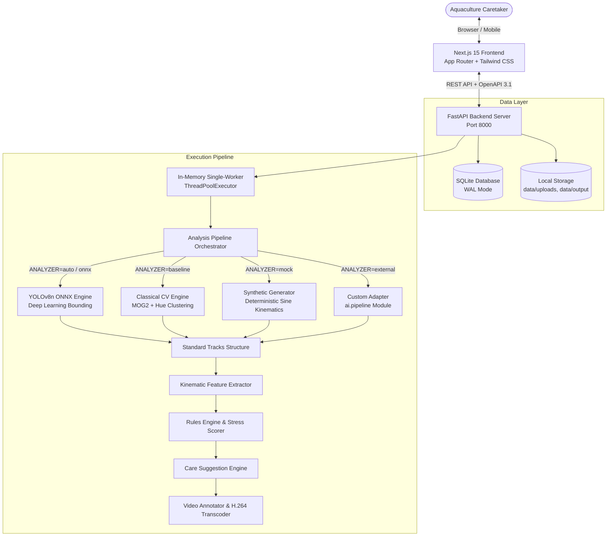

# Matsya

> Non-invasive, automated computer-vision platform for teleost fish behavioral stress detection and individual kinematics tracking.

---

## Overview

In ornamental aquaculture and fish farming, stress is the primary precursor to disease outbreaks and mortality. Traditional monitoring relies on manual visual checks or post-mortem laboratory examinations, by which point intervention is often too late.

Matsya processes aquarium video into rule-based behavioural indicators and individual trajectory visualisations. Its project-selected stress score is not clinically validated and is not a veterinary diagnosis. By segmenting and tracking individual fish swimming trajectories, measuring vertical water column distribution, detecting erratic turning angles, and evaluating social spacing using project-configured thresholds, the platform computes a rule-based project stress indicator, visualizes individual trajectory overlays, and generates prioritized tank care recommendations.

---

## System Architecture



---

## Supported operating envelope and limitations

The intended evaluation envelope is goldfish, fixed camera, 1–6 fish, 10–90 second footage, at least 480p, and reasonably clear water. Reflections, bubbles, surface shimmer, colour cast, flicker, decor, occlusion, fish colour/pattern and camera motion can reduce detection reliability. The stress score is a rule-based behavioural indicator with project-selected thresholds; expert validation is not available.

## Core Capabilities

| Category | Description |
| :--- | :--- |
| **Video Telemetry** | Drag-and-drop video upload (MP4/MOV/WebM) with multi-condition quality probe evaluating sharpness, contrast, brightness, and camera stability. |
| **Fused Detection & Tracking** | Tri-cue classical background subtraction (MOG2) combined with circular hue clustering, watershed split separation, and stationary fish template matching. |
| **Behavioral Kinematics** | Real-time calculation of swimming speed (BL/s), angular deviation frequency, surface ratio, bottom freezing ratio, and schooling dispersion distance. |
| **Configurable Scoring Engine** | Declarative YAML rules engine (`config/scoring.yaml`) with configurable weights and transparent reliability deductions. |
| **Interactive Results** | Animated radial stress gauge, synchronized timeline seeking, individual fish inspection cards, and annotated bounding boxes. |
| **Historical Analytics** | Fleet Stress Index (FSI) longitudinal tracking, historical session comparisons, and 7-day soft-delete Recycle Bin safety net. |
| **Report Generation** | Standalone multi-page ReportLab PDF export with bundled TrueType typography, timeline graphs, and RFC 5987 Unicode headers. |
| **Accessibility & UX** | High-contrast dark ocean UI theme, zero critical accessibility violations, animation suppression for `prefers-reduced-motion`, and fully responsive layouts across mobile (390px), tablet (768px), and desktop (1440px). |

---

## Quick Start (Linux)

### 1. Prerequisites
- Python 3.12+
- Node.js 20+
- FFmpeg and Poppler utilities (`pdftoppm`)

### 2. Setup
```bash
# Set up Python virtual environment and backend dependencies
python3 -m venv backend/.venv
backend/.venv/bin/pip install -r backend/requirements.txt

# Install frontend dependencies
cd frontend && npm install && cd ..
```

### 3. Launch Development Server
```bash
./scripts/dev.sh
```
- **Web Application**: `http://localhost:3000`
- **FastAPI Documentation**: `http://localhost:8000/api/docs`

---

## Automated Verification

Matsya enforces automated verification across backend algorithms, schema contracts, and browser workflows:

```bash
./scripts/verify_all.sh
```

### Verification Breakdown
Detailed test execution results are documented in `docs/TEST_REPORT.md` and accessible in the application at `/validation`.

- **Backend Suites**: The current suite is run with pytest; generated results are recorded in docs/TEST_REPORT.md.
- **Backend Line Coverage**: Reported only when a valid coverage XML is produced by the verification script.
- **Frontend Static Analysis**: TypeScript, lint, and production build checks run in the verification script.
- **End-to-End Tests**: Playwright workflows are part of the production-like verification path.

---

## Analyzer Modes

The system supports interchangeable computer-vision backends, controlled via the `ANALYZER` environment variable:

| Mode | Environment | Description |
| :--- | :--- | :--- |
| **`auto`** (Default) | `export ANALYZER=auto` | Uses ONNX only when its hold-out evaluation gate passes; otherwise falls back to the classical baseline detector. |
| **`baseline`** | `export ANALYZER=baseline` | Tri-cue classical background subtraction (MOG2) with hue clustering and watershed splitting. Requires no GPU. |
| **`onnx`** | `export ANALYZER=onnx` | OpenCV DNN ONNX inference; model eligibility requires hold-out evidence and no model is shipped without it. |
| **`mock`** | `export ANALYZER=mock` | Deterministic synthetic kinematics generator for rapid testing and demo seeding. Displays transparent "Demo data" UI badge. |

---

## Project Attribution

- **Authorship**: Matsya Project Team
- **Affiliation**: Atria Institute of Technology, Bengaluru, India
- **License**: MIT License
