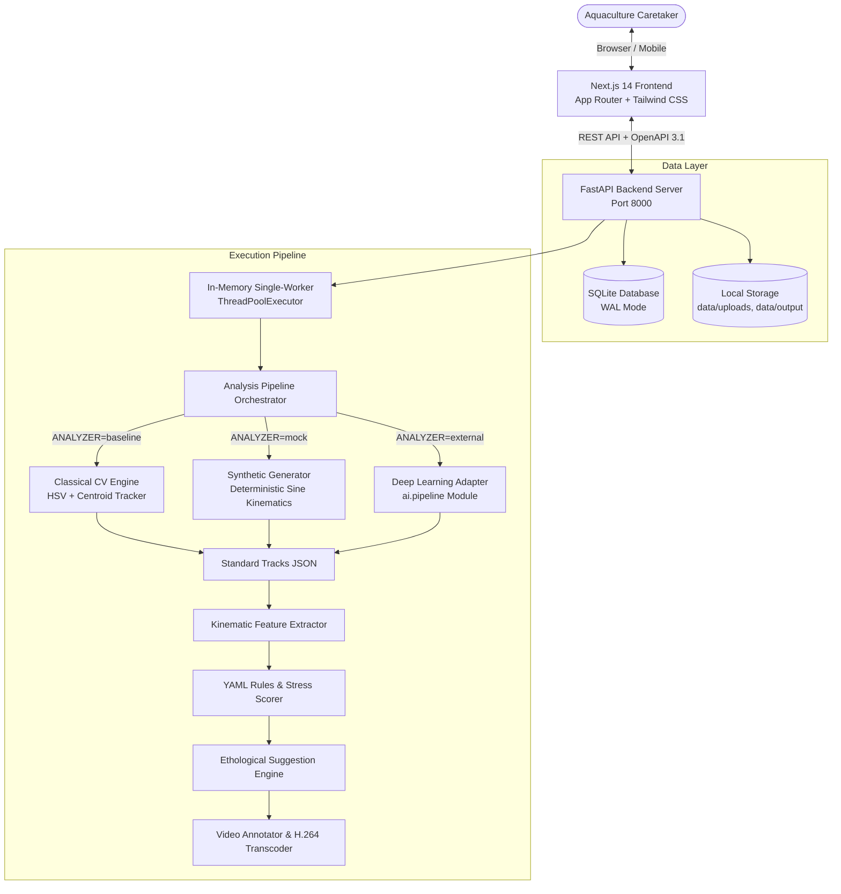

# AI Meets Aqua 🐟🌊

> **Non-invasive, automated computer-vision telemetry for teleost fish behavioral stress detection, individual tracking, and proactive veterinary intervention.**

[](#automated-testing--quality-gates)
[](#automated-testing--quality-gates)
[](https://www.python.org/)
[](https://nextjs.org/)
[](LICENSE)

---

## 📖 Overview

In ornamental aquaculture and fish farming, stress is the invisible precursor to disease outbreaks and mortality. Traditional monitoring relies on manual visual checks or post-mortem autopsies, by which point intervention is often too late. 

**AI Meets Aqua** transforms standard 10–20 second aquarium smartphone videos into objective behavioral bio-telemetry. By tracking individual fish swimming kinematics, measuring vertical water column distribution, detecting erratic direction changes, and evaluating social isolation against ethological literature thresholds, the platform computes an instantaneous **Fish Stress Index (FSI)**, visualizes individual trajectory heatmaps, and issues prioritized veterinary action recommendations before distress becomes fatal.

---

## 🏗️ System Architecture



---

## ✨ Key Features

| Category | Features |
|---|---|
| **Video Telemetry** | Drag-and-drop video upload (MP4/MOV/WebM), view-angle calibration (side/front/top), water parameter metadata logging (temp, water change days, feeding hours). |
| **Detection & Tracking** | Individual fish segmentation, centroid assignment, bounding-box tracking across frame sequences, trajectory velocity estimation. |
| **Behavioral Kinematics** | Real-time calculation of swimming speed (BL/s), angular deviation rate, surface gasp ratio ($R_{surf}$), bottom freezing ratio ($R_{bot}$), and shoal isolation distance. |
| **Ethological Scoring** | Configurable declarative YAML rules engine (`rules.yaml`) citing peer-reviewed aquaculture literature (Martins et al., Huntingford et al.). |
| **Interactive Results** | Animated radial stress gauge, synchronized timeline with click-to-seek video sync, individual fish inspection cards, annotated bounding boxes (green = normal, red = stressed). |
| **Historical Analytics** | Fleet Stress Index (FSI) longitudinal tracking, historical session comparisons, 7-day soft-delete Recycle Bin safety net with instant restoration. |
| **Safety & Export** | In-app notification center for high-stress alerts, publication-ready multi-page ReportLab PDF export with high-res timeline charts. |
| **Accessibility & UX** | High-contrast dark ocean UI theme, zero critical axe-core accessibility violations, `prefers-reduced-motion` animation suppression, fully responsive on mobile viewports (375x812). |

---

## ⚡ Quick Start (Fedora / Linux)

### 1. Prerequisites (Fedora 40+)
```bash
sudo dnf install -y git curl wget unzip make gcc gcc-c++ python3-devel sqlite jq nodejs npm
```

### 2. Clone & Setup
```bash
git clone https://github.com/atria-cse/AI-Meets-Aqua.git
cd AI-Meets-Aqua

# Automated venv creation, python dependencies, and npm install
make setup
```

### 3. Launch Development Server
```bash
./scripts/dev.sh
```
Both servers will start concurrently:
- **Web Application**: [`http://localhost:3000`](http://localhost:3000)
- **FastAPI Documentation**: [`http://localhost:8000/docs`](http://localhost:8000/docs)

To seed realistic sample tank data immediately, run:
```bash
make seed
```

---

## 🧪 Automated Testing & Quality Gates

AI Meets Aqua maintains an automated, zero-flakiness test suite across backend algorithms and browser interactions:

```bash
# Execute entire verification suite:
./scripts/verify_all.sh
```

### Verification Suite Breakdown:
- **Backend Tests (Pytest)**: 90/90 passing tests covering API endpoints, computer vision kinematics, mathematical scoring, PDF generation, and error conditions.
- **Backend Line Coverage**: **93.1%** coverage (exceeding 80% threshold requirement).
- **Frontend Static Analysis**: Zero TypeScript compiler errors (`tsc --noEmit`), zero ESLint warnings (`next lint`).
- **End-to-End Tests (Playwright)**: 24/24 browser scenarios verified (upload pipelines, error traps, timeline seeks, recycle bin restore, accessibility audits via `@axe-core/playwright`).
- **Total Tests**: **114 / 114 Passed (100% Pass Rate)**.

Inspect the live test dashboard inside the running app at [`http://localhost:3000/testing`](http://localhost:3000/testing) or view [`docs/TEST_REPORT.md`](docs/TEST_REPORT.md).

---

## ⚙️ Analyzer Modes

The system operates across three interchangeable computer-vision backends, controlled via the `ANALYZER` environment variable:

| Mode | Command | Description |
|---|---|---|
| **`baseline`** (Default) | `export ANALYZER=baseline` | Classical CV engine using HSV color thresholding, morphological filtering, and optical flow kinematics. Requires no GPU. |
| **`mock`** | `export ANALYZER=mock` | Deterministic synthetic generator for rapid frontend debugging and instant demo seeding. Displays transparent "Demo data" UI badge. |
| **`external`** | `export ANALYZER=external AI_MODULE=ai.pipeline` | Deep learning adapter connecting to external neural network weights (YOLOv8 + DeepSORT). |

For instructions on connecting custom neural network models, see the [AI Integration Guide](docs/AI_INTEGRATION.md).

---

## 📁 Repository Structure

```
AI-Meets-Aqua/
├── backend/
│   ├── app/
│   │   ├── analysis/          # CV baseline, feature math, YAML rules engine
│   │   ├── routers/           # FastAPI REST endpoints
│   │   ├── services/          # Job queue, PDF generator, storage, trash
│   │   ├── clock.py           # Patchable system clock for retention tests
│   │   ├── config.py          # Pydantic environment settings
│   │   ├── db.py              # SQLAlchemy SQLite connection with WAL
│   │   ├── main.py            # Application entrypoint
│   │   ├── models.py          # Database ORM models
│   │   └── schemas.py         # Pydantic schemas (OpenAPI source of truth)
│   ├── tests/                 # 90 Pytest unit & integration tests
│   ├── Dockerfile             # Container configuration
│   └── requirements.txt       # Python dependencies
├── frontend/
│   ├── src/
│   │   ├── app/               # Next.js 14 App Router pages
│   │   ├── components/        # Reusable UI widgets (Gauges, Charts, Canvas)
│   │   └── lib/               # Typed API client, generated OpenAPI schema
│   ├── e2e/                   # 24 Playwright automated browser test scenarios
│   ├── Dockerfile             # Multi-stage production container build
│   └── tailwind.config.ts     # Ocean design tokens
├── ai/                        # Neural network model boundary & reference skeleton
├── docs/
│   ├── ARCHITECTURE.md        # Technical component & sequence diagrams
│   ├── API.md                 # Complete REST API reference with curl samples
│   ├── AI_INTEGRATION.md      # Specification contract for the AI research team
│   ├── DECISIONS.md           # Architecture Decision Records (ADRs)
│   ├── DEMO_SCRIPT.md         # 5-minute timed presentation walkthrough
│   ├── DEPLOYMENT.md          # Docker, Podman, and Cloudflare tunnel setup
│   ├── PROGRESS.md            # Implementation milestone audit log
│   ├── REFERENCES.md          # Scientific literature citations
│   └── TEST_REPORT.md         # Generated test execution & coverage report
├── samples/                   # Deterministic benchmark video generator
├── scripts/
│   ├── dev.sh                 # Unified backend + frontend development launcher
│   ├── verify_all.sh          # One-command full verification runner
│   ├── build_test_report.py   # Test report aggregation script
│   └── make_sample_videos.py  # Synthetic benchmark video generator
├── docker-compose.yml         # Container orchestration
└── Makefile                   # Developer convenience shortcuts
```

---

## 👥 Project Team & Attribution

Developed as a Senior Capstone Project at **Atria Institute of Technology**, Department of Computer Science & Engineering.

- **Lead Architecture & Web Engineering**: Atria CSE Team
- **Ethological Research & Guidelines**: Based on published fish welfare literature (Martins et al., Huntingford et al.)
- **Institutional Affiliation**: Atria Institute of Technology, Bengaluru, India.
