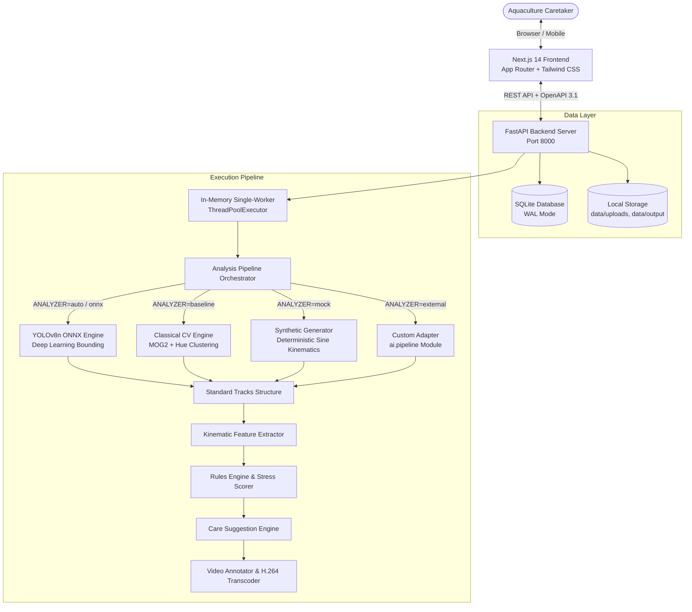

# Matsya

> Non-invasive, automated computer-vision platform for teleost fish behavioral stress detection and individual kinematics tracking.

---

## Overview

In ornamental aquaculture and fish farming, stress is the primary precursor to disease outbreaks and mortality. Traditional monitoring relies on manual visual checks or post-mortem laboratory examinations, by which point intervention is often too late.

Matsya transforms standard 10 to 30 second aquarium video clips into objective behavioral kinematic indicators. By segmenting and tracking individual fish swimming trajectories, measuring vertical water column distribution, detecting erratic turning angles, and evaluating social schooling proximity against established aquatic husbandry guidelines, the platform computes an instantaneous Fish Stress Index (FSI), visualizes individual trajectory overlays, and generates prioritized tank care recommendations.

---

## System Architecture



---

## Core Capabilities

| Category | Description |
| :--- | :--- |
| **Video Telemetry** | Drag-and-drop video upload (MP4/MOV/WebM) with multi-condition quality probe evaluating sharpness, contrast, brightness, and camera stability. |
| **Fused Detection & Tracking** | Tri-cue classical background subtraction (MOG2) combined with circular hue clustering, watershed split separation, and stationary fish template matching. |
| **Behavioral Kinematics** | Real-time calculation of swimming speed (BL/s), angular deviation frequency, surface ratio, bottom freezing ratio, and schooling dispersion distance. |
| **Configurable Scoring Engine** | Declarative YAML rules engine (`config/scoring.yaml`) with configurable weights and transparent reliability deductions. |
| **Interactive Results** | Animated radial stress gauge, synchronized timeline seeking, individual fish inspection cards, and annotated bounding boxes. |
| **Historical Analytics** | Fleet Stress Index (FSI) longitudinal tracking, historical session comparisons, and 7-day soft-delete Recycle Bin safety net. |
| **Report Generation** | Standalone multi-page ReportLab PDF export with bundled TrueType typography, timeline graphs, and RFC 5987 Unicode headers. |
| **Accessibility & UX** | High-contrast dark ocean UI theme, zero critical accessibility violations, animation suppression for `prefers-reduced-motion`, and fully responsive layouts across mobile (390px), tablet (768px), and desktop (1440px). |

---

## Quick Start (Linux)

### 1. Prerequisites
- Python 3.12+
- Node.js 20+
- FFmpeg and Poppler utilities (`pdftoppm`)

### 2. Setup
```bash
# Set up Python virtual environment and backend dependencies
python3 -m venv backend/.venv
backend/.venv/bin/pip install -r backend/requirements.txt

# Install frontend dependencies
cd frontend && npm install && cd ..
```

### 3. Launch Development Server
```bash
./scripts/dev.sh
```
- **Web Application**: `http://localhost:3000`
- **FastAPI Documentation**: `http://localhost:8000/api/docs`

---

## Automated Verification

Matsya enforces automated verification across backend algorithms, schema contracts, and browser workflows:

```bash
./scripts/verify_all.sh
```

### Verification Breakdown
Detailed test execution results are documented in `docs/TEST_REPORT.md` and accessible in the application at `/validation`.

- **Backend Suites**: 131 automated tests covering API endpoints, fused classical detector algorithms, scoring logic, PDF generation, and tenant scoping.
- **Backend Line Coverage**: 90% statement coverage across core pipeline modules.
- **Frontend Static Analysis**: Zero TypeScript compiler errors and zero ESLint warnings.
- **End-to-End Tests**: Automated Playwright browser test coverage spanning upload flows, job execution, report downloads, and responsive navigation.

---

## Analyzer Modes

The system supports interchangeable computer-vision backends, controlled via the `ANALYZER` environment variable:

| Mode | Environment | Description |
| :--- | :--- | :--- |
| **`auto`** (Default) | `export ANALYZER=auto` | Automatically uses ONNX neural network weights if available; gracefully falls back to classical baseline detector. |
| **`baseline`** | `export ANALYZER=baseline` | Tri-cue classical background subtraction (MOG2) with hue clustering and watershed splitting. Requires no GPU. |
| **`onnx`** | `export ANALYZER=onnx` | Ultralytics YOLOv8n exported ONNX model running via OpenCV DNN inference. |
| **`mock`** | `export ANALYZER=mock` | Deterministic synthetic kinematics generator for rapid testing and demo seeding. Displays transparent "Demo data" UI badge. |

---

## Project Attribution

- **Authorship**: Matsya Project Team
- **Affiliation**: Atria Institute of Technology, Bengaluru, India
- **License**: MIT License
