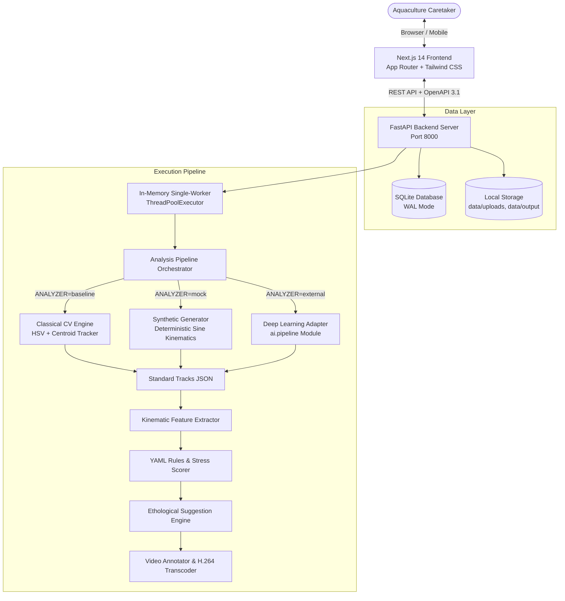
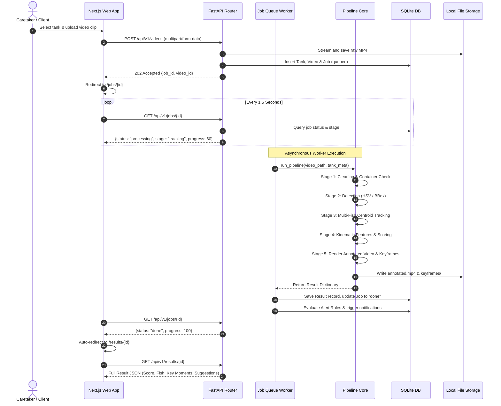
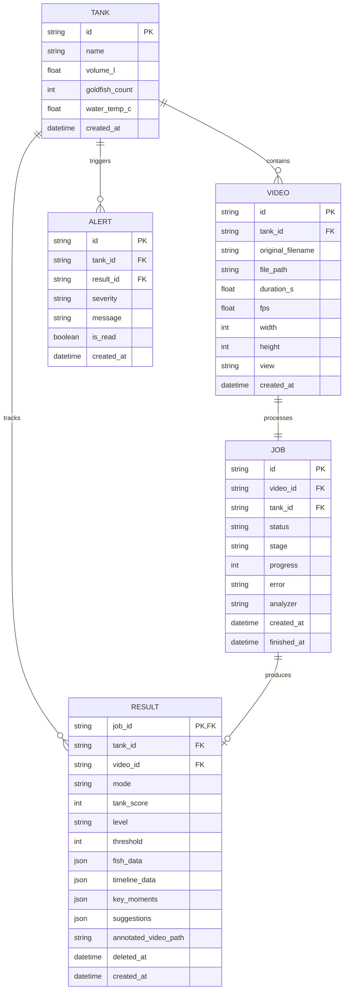

# System Architecture & Technical Design

This document details the architectural design, component interactions, mathematical formulations, and engineering principles behind **AI Meets Aqua**.

---

## 1. Executive Summary & Problem Formulation

In domestic and commercial aquaculture, **stress** is the leading precursor to teleost disease epidemics and mortality. Conventional diagnostic practices rely on manual visual inspection by caretakers or post-mortem laboratory autopsies. By the time physical clinical signs manifest (e.g., fin rot, dropsy, continuous piping), the stress cascade is often irreversible.

**AI Meets Aqua** provides non-invasive, objective, continuous video-based behavioral telemetry. By decomposing tank video feeds into individual fish trajectories, extracting ethological kinematics (speed, turning rate, depth distribution, shoaling dispersion), and mapping them through transparent scoring models, the system identifies acute distress early and recommends specific interventions.

---

## 2. High-Level Component Architecture

---

## 3. End-to-End Analysis Lifecycle (Sequence Diagram)

---

## 4. Entity-Relationship Data Model

---

## 5. Mathematical Stress Model & Behavioral Scoring

Fish stress scoring is calculated by measuring four bio-behavioral telemetry features extracted across sequential frame windows:

### 5.1 Kinematic Formulations

1. **Normalized Swimming Velocity ($v_{bl}$)**:
   $$\bar{v}_{bl} = \frac{1}{N-1} \sum_{k=1}^{N-1} \frac{\|\mathbf{p}_{k+1} - \mathbf{p}_k\|_2}{\bar{L}_{body} \cdot \Delta t}$$
   where $\mathbf{p}_k$ is the $(x, y)$ fish centroid at frame $k$, $\bar{L}_{body}$ is the average bounding-box major axis length (pixels), and $\Delta t = 1/f_{fps}$.

2. **Angular Deviation Rate ($\omega_{turn}$)**:
   $$\theta_k = \text{atan2}(y_k - y_{k-1}, x_k - x_{k-1})$$
   $$\Delta \theta_k = |(\theta_{k+1} - \theta_k + \pi) \pmod{2\pi} - \pi|$$
   A turn event is registered when $\Delta \theta_k > 60^\circ$ within 0.3s.

3. **Vertical Spatial Distribution ($R_{surf}, R_{bot}$)**:
   $$R_{surf} = \frac{1}{N} \sum_{k=1}^N \mathbb{I}(y_k < 0.20 \cdot H_{tank})$$
   $$R_{bot} = \frac{1}{N} \sum_{k=1}^N \mathbb{I}(y_k > 0.80 \cdot H_{tank})$$

4. **Shoal Isolation Index ($D_{iso}$)**:
   $$D_{iso} = \frac{1}{N} \sum_{k=1}^N \mathbb{I}\left(\min_{j \neq i} \|\mathbf{p}_i(k) - \mathbf{p}_j(k)\|_2 > 2.5 \cdot \bar{L}_{body}\right)$$

### 5.2 Scoring Rules Matrix (defined in `rules.yaml`)

| Behavioral Flag | Trigger Condition | Points Allocated | Ethological Cause |
|---|---|---|---|
| `fast_swimming` | $v_{bl} > 2.5\text{ BL/s}$ for $>25\%$ time | +25 | Panic, fright, acute ammonia spike |
| `erratic_swimming` | $\omega_{turn} > 0.8\text{ turns/s}$ | +25 | Parasite irritation, water pH shift |
| `surface_gasping` | $R_{surf} > 0.30$ (front/side views) | +35 | Hypoxia (dissolved $O_2 < 4.0\text{ mg/L}$), nitrite |
| `bottom_freezing` | $R_{bot} > 0.40 \land v_{bl} < 0.3$ | +25 | Thermal shock, lethargy, swim bladder |
| `social_isolation` | $D_{iso} > 0.50$ | +15 | Social ostracization, illness weakness |

**Individual Fish Stress Score**:
$$\text{Score}_{fish} = \min\left(100, \sum \text{Points}_{flags}\right)$$

**Tank Overall Stress Score**:
$$\text{Score}_{tank} = \max_{i} \text{Score}_{fish, i}$$

**Health Categorization**:
$$\text{Level} = \begin{cases} 
\text{Normal} & \text{if } \text{Score}_{tank} \le 34 \\
\text{Moderate} & \text{if } 35 \le \text{Score}_{tank} \le 64 \\
\text{High} & \text{if } \text{Score}_{tank} \ge 65 
\end{cases}$$

---

## 6. Limitations & Future Roadmap

1. **Single-View 2D vs. 3D Volumetric Tracking**:
   Current tracking assumes single-camera orthogonal footage (side or front). Future releases will incorporate calibrated multi-view stereo cameras for 3D Euclidean trajectory reconstruction.
2. **Deep Neural Network Integration**:
   The current classical computer-vision baseline segments fish by color kinematics. Our planned YOLOv8-pose fish model will track individual fin articulation and gill movement rates (opercula beats).
3. **Multi-Sensor Fusion**:
   Integrating IoT telemetry (ammonia, dissolved oxygen, pH, temperature probes) to cross-validate behavioral anomalies against physical water chemistry in real time.
