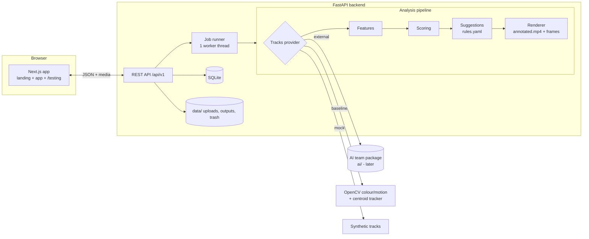

# AI Meets Aqua: Implementation Plan (Frontend + Backend)

> **Audience:** an autonomous coding agent that has **no prior knowledge** of this project or this codebase.
> **Owner:** the human developer (backend/lead) on a **Fedora Linux** machine.
> **Deadline:** a live evaluation **tomorrow** (a prep round for the Nov 19 CIE). Evaluators will ask the team to
> (1) **present the project design**, (2) **demonstrate the implementation**, (3) **show testing results**.
> Everything in this plan exists to make those three things go flawlessly.

Save this file in the repository as `docs/IMPLEMENTATION_PLAN.md` and keep it up to date as you work.

---

## 0. Agent operating rules (read first, follow always)

1. **Read this whole document before writing any code.** Then execute the phases in Section 11 in order.
2. **Do not ask the human questions.** Every decision you need is in this document. If something is genuinely
   ambiguous, choose the simplest option that satisfies the acceptance criteria, and record the choice in
   `docs/DECISIONS.md` (one line: date, decision, reason).
3. **Priorities:** `P0` = must work tomorrow. `P1` = should work. `P2` = only if time remains. Finish **all P0 items
   (and their tests) before touching any P1**. Never leave P0 broken to polish P1.
4. **Never fake results silently.** Mock/demo data must always be labelled (`"mode": "mock"` in JSON and a visible
   "Demo data" badge in the UI). Real analysis is labelled `"baseline"` or `"external"`.
5. **Test as you go.** Every phase ends with a **gate**: run the listed commands; do not start the next phase
   until the gate passes. Record gate outcomes in `docs/PROGRESS.md`.
6. **Commit after every phase** (`git add -A && git commit -m "phase N: <summary>"`). Small, reversible steps.
7. **No placeholder content** (no lorem ipsum, no "TODO", no empty pages, no dead buttons, no console errors).
8. **Pin and record versions.** After installing dependencies, freeze them (`requirements.txt`, `package-lock.json`).
9. **Do not use paid services, API keys or accounts.** Everything must run offline on the developer's laptop
   (fonts are fetched once at build time).
10. **Keep a running log** in `docs/PROGRESS.md`: phase, start/end time, what was done, test results, known issues.
11. **When blocked for more than 15 minutes** on one problem, apply the documented fallback (each risky item has one)
    and move on.
12. **Final output:** follow the report format in Section 18.

---

## 1. Project context (what you are building and why)

**AI Meets Aqua** is a web application that detects **stress in goldfish** from a **tank video**.

* Problem: in shared tanks, one stressed or sick fish quickly affects the others (shared water). Caretakers rely on
  manual observation and notice behaviour changes late (isolation, erratic swimming, reduced activity).
* Solution (web version, software only): the user uploads a 30 to 60 second video of a goldfish tank. The system
  analyses it and returns:
  * a **tank stress score (0 to 100)** and level (Normal / Moderate / High),
  * a **per-fish stress score**, each fish with a stable ID (`Fish_1`, `Fish_2`, ...),
  * an **annotated video** (green box = normal fish, red box = stressed fish),
  * a **stress timeline** and **key moments** (for example "Fish_2 at the surface, 12.5 s"),
  * **action-based suggestions** in the form *Behaviour, Possible cause, Suggested action*,
  * a **history per tank**, a **Fish Stress Index (FSI)**, **alerts**, and a **7-day recycle bin** for deleted analyses.
* Four behaviour signals are measured: **swimming speed, direction changes (erratic swimming), isolation,
  vertical position (surface gasping or bottom inactivity)**.
* University: Atria Institute of Technology, Dept. of CSE. SDGs addressed: 6, 12, 14.
* Team split: **Frontend (2 devs), Backend (1 dev, this repo's owner), AI (2 devs, working separately)**.

### 1.1 What is NOT your job (very important)

The **AI model** (YOLOv8 goldfish detector, DeepSORT tracker, trained classifier) is being built **by another group**.
Your job is the **web application around it**, plus a working analysis pipeline that does **not depend on their model**:

| Mode | What it is | Who writes it |
|---|---|---|
| `baseline` | A real, classical computer-vision analyzer (colour and motion based detection, centroid tracking, rule-based scoring). Works on real goldfish videos today. | **You** |
| `mock` | Deterministic synthetic tracks, fed through the *same* scoring, suggestions and rendering code. For tests and emergencies. Always labelled. | **You** |
| `external` | Adapter that calls the AI team's code (`ai/` package) when it appears. | **You write the adapter**, they write the model |

The system must run end to end in `baseline` mode tomorrow, and switch to the AI team's model by changing **one
environment variable** (`ANALYZER=external`) with no other code change. See Section 4.2 and Section 9.4.

---

## 2. Deliverables and success criteria

### 2.1 Mapping to the evaluation

| Evaluator asks for | What you must deliver | Where |
|---|---|---|
| **Present project design** | Architecture diagrams, data model, API spec, scoring spec, AI boundary, design rationale | `docs/ARCHITECTURE.md`, `docs/API.md`, landing page "How it works", `README.md` |
| **Demonstrate implementation** | Polished landing page + full working app, running locally with sample videos and seeded history | the running app, `docs/DEMO_SCRIPT.md`, `samples/` |
| **Show testing results** | Automated backend + end-to-end tests, coverage, a generated report, and an in-app **/testing** page | `docs/TEST_REPORT.md`, `frontend/public/test-results.json`, `/testing` route |

### 2.2 Definition of done (all must be true)

* [ ] `./scripts/dev.sh` starts backend (port 8000) and frontend (port 3000) with one command.
* [ ] A user can: create a tank, upload a video, watch live progress, see the results page (gauge, per-fish cards,
      timeline, annotated video that plays in the browser, key moments, suggestions), see history and FSI, delete and
      restore from the recycle bin, receive an alert, download a PDF report.
* [ ] `./scripts/verify_all.sh` runs **all** automated tests and produces `docs/TEST_REPORT.md` and
      `frontend/public/test-results.json`. All P0 tests pass.
* [ ] Backend line coverage >= 80% (`pytest --cov`).
* [ ] `npm run build`, `npx tsc --noEmit`, `npm run lint` all pass with zero errors.
* [ ] Five sample videos exist in `samples/` (generated by script) with a `manifest.json` of expected outcomes.
* [ ] Docs in Section 14 exist and are accurate.
* [ ] `docs/PROGRESS.md` is complete and the final report (Section 18) is printed.

---

## 3. Scope and priorities

### 3.1 Feature list

| ID | Feature | Priority |
|---|---|---|
| F1 | Tank profiles (create, list, delete) | P0 |
| F2 | Video upload with validation and optional details | P0 |
| F3 | Async job with live stage and progress | P0 |
| F4 | `baseline` analyzer producing real tracks, features, scores | P0 |
| F5 | Annotated video (browser-playable H.264) and key frames | P0 |
| F6 | Results API + results page (gauge, fish cards, timeline, metrics) | P0 |
| F7 | Suggestions engine (Behaviour, Cause, Action) from editable YAML rules | P0 |
| F8 | History per tank + trend | P0 |
| F9 | Landing page inspired by hackfest.dev (original underwater design) | P0 |
| F10 | `mock` analyzer + demo seed endpoint ("Try a sample") | P0 |
| F11 | Automated tests + test report + `/testing` page | P0 |
| F12 | Recycle bin (soft delete, restore, 7-day purge) | P1 |
| F13 | Alerts (dashboard pop-up, bell) + alert settings; email outbox | P1 |
| F14 | FSI + insight messages | P1 |
| F15 | PDF report download | P1 |
| F16 | `external` adapter for the AI team | P1 |
| F17 | Dockerfiles + deployment notes | P2 |
| F18 | Input transcoding fallback (HEVC / odd formats) | P2 |

### 3.2 Non-goals (do not build)

User accounts or login, payments, real SMS/WhatsApp, live camera streaming, multi-species support, mobile app,
model training code (that belongs to the AI group). The app is single-user for the demo; state this in the docs.

---

## 4. Architecture

### 4.1 Overview



### 4.2 The AI boundary (contract the AI group will implement)

The pipeline is organised around a **Tracks** object. Anything that can produce Tracks can drive the whole app.

```json
{
  "fps": 15.0, "width": 640, "height": 360, "duration_s": 20.0,
  "frames": [
    { "t": 0.0, "detections": [ { "id": "Fish_1", "bbox": [x1, y1, x2, y2], "conf": 0.91 } ] }
  ]
}
```

The `external` adapter (`backend/app/analysis/external.py`) supports **two** integration styles, chosen by what the
module in `AI_MODULE` (default `ai.pipeline`) exposes:

1. **Preferred, tracks only:** `detect_and_track(video_path: str, progress_cb) -> dict` returning the Tracks JSON
   above. Scoring, suggestions and rendering then reuse the backend code, so the UI is unchanged.
2. **Full result:** `analyze_video(video_path: str, meta: dict, progress_cb, out_dir: str) -> dict` returning the
   full Result JSON of Section 7.3 and writing `annotated.mp4` and `frames/*.jpg` into `out_dir`.

`progress_cb(stage: str, percent: int)` where `stage` is one of `cleaning, detecting, tracking, analysing, rendering`.
Document this in `docs/AI_INTEGRATION.md` (Section 14) so the AI group can plug in without reading your code.

### 4.3 Key design decisions (also put in `docs/DECISIONS.md`)

* **FastAPI + SQLite + local disk**: zero external services, runs on a laptop, easy to demo.
* **One worker thread**: video analysis is CPU heavy; a queue of one keeps behaviour predictable.
* **Classical CV baseline**: delivers real analysis tomorrow without waiting for the trained model.
* **Rules in YAML**: suggestions and thresholds are editable by non-programmers and citable in the paper.
* **Honest labelling**: `mode` is part of every result.
* **Next.js 14 (App Router) + Tailwind 3**: matches the inspiration site's stack and gives fast, polished pages.

---

## 5. Environment setup (Fedora)

Run these **once**. Commands assume Fedora 40+ with `dnf`. Use `sudo` where shown.

### 5.1 System packages

```bash
sudo dnf install -y git curl wget unzip make gcc gcc-c++ python3-devel sqlite jq \
    nodejs npm poppler-utils
node --version    # must be >= 20 (if lower: sudo dnf install -y nodejs20 or use nvm, see 17.4)
npm --version
```

### 5.2 Python 3.12 through `uv` (avoids wheel problems on very new system Pythons)

```bash
curl -LsSf https://astral.sh/uv/install.sh | sh
source "$HOME/.local/bin/env" 2>/dev/null || export PATH="$HOME/.local/bin:$PATH"
uv --version
uv python install 3.12
```

### 5.3 Create the repo and backend environment

```bash
mkdir -p ~/ai-meets-aqua && cd ~/ai-meets-aqua
git init
mkdir -p backend frontend ai docs scripts samples
cd backend
uv venv --python 3.12 .venv
source .venv/bin/activate
```

`backend/requirements.txt` (create exactly this, then install):

```text
fastapi>=0.110
uvicorn[standard]>=0.29
sqlalchemy>=2.0
pydantic>=2.6
pydantic-settings>=2.2
python-multipart>=0.0.9
pyyaml>=6.0
numpy>=1.26
scipy>=1.11
opencv-python-headless>=4.9
imageio-ffmpeg>=0.4.9
reportlab>=4.1
matplotlib>=3.8
```

`backend/requirements-dev.txt`:

```text
-r requirements.txt
pytest>=8.0
pytest-cov>=5.0
httpx>=0.27
freezegun>=1.4
pypdf>=4.0
ruff>=0.4
```

```bash
uv pip install -r requirements-dev.txt
python -c "import cv2, numpy, fastapi, imageio_ffmpeg; print(cv2.__version__, imageio_ffmpeg.get_ffmpeg_exe())"
```

> **Do not rely on the system `ffmpeg`.** On Fedora the stock `ffmpeg-free` lacks the H.264 encoder. The bundled
> binary from `imageio-ffmpeg` includes `libx264`, which is required for browser-playable annotated videos.
> Do not install `opencv-python` (the GUI build); use `opencv-python-headless` only (avoids `libGL` errors).

### 5.4 Frontend scaffold

```bash
cd ~/ai-meets-aqua
npx --yes create-next-app@14 frontend --typescript --tailwind --eslint --app --src-dir \
    --import-alias "@/*" --use-npm
cd frontend
npm install framer-motion recharts lucide-react @tanstack/react-query clsx
npm install -D @playwright/test @axe-core/playwright openapi-typescript
```

### 5.5 Playwright browser on Fedora (Playwright does not officially support Fedora; use this)

```bash
cd ~/ai-meets-aqua/frontend
sudo dnf install -y nss atk at-spi2-atk cups-libs libdrm libxkbcommon libXcomposite libXdamage \
    libXrandr mesa-libgbm alsa-lib pango cairo libXfixes libxshmfence
PLAYWRIGHT_SKIP_VALIDATE_HOST_REQUIREMENTS=1 npx playwright install chromium
```

Fallback if the download or launch fails: `sudo dnf install -y chromium` and set
`PLAYWRIGHT_CHROMIUM_EXECUTABLE=/usr/bin/chromium-browser` (check with `which chromium-browser chromium`);
`playwright.config.ts` must read that variable into `launchOptions.executablePath` when set.

### 5.5b Firewall (only if the demo is shown from another device on the LAN)

```bash
sudo firewall-cmd --add-port=3000/tcp --add-port=8000/tcp
```

### 5.6 Environment checks (run, and record results in `docs/PROGRESS.md`)

```bash
python --version; node --version; npm --version; git --version
python -c "import cv2; print('opencv ok', cv2.__version__)"
python - <<'PY'
import imageio_ffmpeg, subprocess
exe = imageio_ffmpeg.get_ffmpeg_exe()
out = subprocess.run([exe, "-hide_banner", "-encoders"], capture_output=True, text=True).stdout
print("libx264 available:", "libx264" in out)
PY
```

If `libx264 available: False`, use the WebM fallback in Section 9.5.

---

## 6. Repository layout

```text
ai-meets-aqua/
├── README.md
├── Makefile                      # make dev | test | verify | seed | clean
├── .gitignore                    # .venv, node_modules, backend/data, .next, test-results, __pycache__
├── backend/
│   ├── requirements.txt  requirements-dev.txt  pytest.ini  .env.example
│   ├── app/
│   │   ├── main.py               # app factory, CORS, routers, error handlers, startup tasks
│   │   ├── config.py             # pydantic-settings (env driven)
│   │   ├── db.py                 # engine, session, Base
│   │   ├── models.py             # SQLAlchemy models
│   │   ├── schemas.py            # Pydantic models (the API contract)
│   │   ├── errors.py             # AppError + handlers -> {"error": {...}}
│   │   ├── clock.py              # now() function, patchable in tests
│   │   ├── routers/              # tanks.py videos.py jobs.py results.py history.py trash.py alerts.py system.py demo.py
│   │   ├── services/             # storage.py jobs.py alerts.py insights.py trash.py report_pdf.py
│   │   └── analysis/
│   │       ├── types.py  features.py  scoring.py  suggestions.py  render.py  pipeline.py
│   │       ├── tracks_baseline.py  tracks_mock.py  external.py  video_io.py
│   │       └── config/ scoring.yaml  rules.yaml
│   ├── tests/                    # conftest.py + test_*.py (Section 12)
│   └── data/                     # runtime only (uploads/, outputs/, trash/, aqua.db), git-ignored
├── ai/                           # EMPTY placeholder + README for the AI group (Section 14.6)
├── frontend/
│   ├── src/app/                  # routes (Section 10.2)
│   ├── src/components/           # ui/, landing/, app/, charts/
│   ├── src/lib/                  # api.ts, types.ts (generated), format.ts, hooks.ts
│   ├── e2e/                      # Playwright specs
│   ├── playwright.config.ts
│   └── public/                   # logo svg, test-results.json (generated)
├── samples/                      # generated videos + manifest.json
├── scripts/
│   ├── dev.sh  verify_all.sh  make_sample_videos.py  build_test_report.py
└── docs/
    ├── IMPLEMENTATION_PLAN.md  PROGRESS.md  DECISIONS.md  ARCHITECTURE.md  API.md
    ├── AI_INTEGRATION.md  DEMO_SCRIPT.md  TEST_REPORT.md  REFERENCES.md
```

---

## 7. Shared contracts

### 7.1 Conventions

* Base path `/api/v1`. JSON in and out. IDs are UUID4 strings. Timestamps are ISO 8601 UTC.
* **Error format (all errors):** `{"error": {"code": "string_snake_case", "message": "Human readable", "details": {}}}`
  with correct HTTP status (400, 404, 409, 413, 415, 422, 500). The frontend shows `error.message`.
* CORS allowed origins from env `CORS_ORIGINS` (default `http://localhost:3000,http://127.0.0.1:3000`), plus optional
  regex env `CORS_ORIGIN_REGEX` (for `*.vercel.app` and `*.trycloudflare.com` when deployed).

### 7.2 Endpoints

| Method | Path | Purpose | Success | Notable errors |
|---|---|---|---|---|
| GET | `/health` | liveness | 200 `{"status":"ok"}` | |
| GET | `/api/v1/system/info` | version, analyzer mode, limits | 200 | |
| POST | `/api/v1/tanks` | create tank | 201 Tank | 422 |
| GET | `/api/v1/tanks` | list tanks | 200 list | |
| GET | `/api/v1/tanks/{id}` | one tank | 200 | 404 |
| DELETE | `/api/v1/tanks/{id}` | delete tank and its data | 204 | 404 |
| POST | `/api/v1/videos` | multipart upload; starts job | 202 `{job_id, video_id}` | 404 tank, 413, 415, 422 |
| GET | `/api/v1/jobs/{id}` | status, stage, progress | 200 Job | 404 |
| GET | `/api/v1/results/{id}` | full result (id = job id) | 200 Result | 404, 409 not ready, 410 deleted |
| GET | `/api/v1/results/{id}/video` | annotated video (HTTP range supported) | 200/206 | 404, 410 |
| GET | `/api/v1/results/{id}/frames/{name}` | key frame jpg | 200 | 404 |
| GET | `/api/v1/results/{id}/report.pdf` | PDF report | 200 | 404, 409 |
| DELETE | `/api/v1/results/{id}` | soft delete to recycle bin (`?permanent=true` hard delete) | 204 | 404 |
| POST | `/api/v1/results/{id}/restore` | restore from bin | 200 | 404, 409 |
| GET | `/api/v1/history` | paged analyses (`tank_id`, `page`, `page_size`) | 200 | |
| GET | `/api/v1/trash` | analyses in bin with `days_remaining` | 200 | |
| POST | `/api/v1/trash/purge` | purge expired items now | 200 `{purged: n}` | |
| GET | `/api/v1/insights` | FSI + messages (`tank_id`) | 200 | 404 |
| GET | `/api/v1/alerts` | list (`unread=true` optional) | 200 | |
| POST | `/api/v1/alerts/{id}/read` | mark read | 200 | 404 |
| GET / PUT | `/api/v1/settings/alerts` | alert preferences | 200 | 422 |
| POST | `/api/v1/demo/seed` | create sample tank + 3 labelled mock results (idempotent) | 200 `{tank_id, result_ids}` | |

### 7.3 Data shapes (Pydantic models in `schemas.py`; the frontend types are generated from OpenAPI)

**Tank:** `id, name (1-60 chars), volume_l (1-5000), goldfish_count (1-20), water_temp_c (0-40, optional), created_at`.

**Upload form fields** (multipart): `file` (required), `tank_id` (required), `view` (`side` | `front` | `top`,
default `side`), `water_temp_c` (optional), `last_water_change_days` (optional int 0-365), `last_fed_hours`
(optional int 0-72).

**Job:** `id, video_id, tank_id, status (queued|processing|done|failed), stage (queued|cleaning|detecting|tracking|analysing|rendering|done),
progress (0-100), error (nullable), analyzer, created_at, started_at, finished_at`.

**Result (the main contract):**

```json
{
  "job_id": "uuid", "mode": "baseline",
  "tank": { "id": "uuid", "name": "Living room 60L", "goldfish_count": 3 },
  "created_at": "2026-11-12T09:30:00Z", "analysis_time_s": 12.4,
  "video": { "duration_s": 20.0, "fps": 15.0, "width": 640, "height": 360, "view": "side" },
  "tank_score": 52, "level": "Moderate", "threshold": 35,
  "fish": [
    {
      "id": "Fish_1", "score": 40, "stressed": true,
      "flags": ["surface_gasping", "fast_swimming", "erratic_swimming"],
      "metrics": { "speed_bl_s": 5.1, "direction_change_rate": 1.2, "isolation_ratio": 0.0,
                   "surface_ratio": 0.62, "bottom_ratio": 0.0, "inactivity_ratio": 0.02 },
      "points": [ { "flag": "surface_gasping", "points": 20 }, { "flag": "fast_swimming", "points": 10 } ],
      "explanation": "Fish_1 spent 62% of the clip near the surface and swam about 5 body lengths per second.",
      "timeline": [ { "t": 0.0, "score": 20 } ]
    }
  ],
  "timeline": [ { "t": 0.0, "score": 18 }, { "t": 5.0, "score": 52 } ],
  "key_moments": [ { "t": 12.5, "fish": "Fish_1", "behaviour": "surface_gasping", "label": "Near surface",
                     "frame_url": "/api/v1/results/<id>/frames/kf_01.jpg" } ],
  "suggestions": [ { "priority": "high", "fish": ["Fish_1"], "behaviour": "surface_gasping",
                     "cause": "Low oxygen, high ammonia or warm water",
                     "action": "Turn on the air pump or increase aeration; check temperature; test ammonia",
                     "source": "rules.yaml#surface_gasping" } ],
  "warnings": [ "Top-down view: vertical position signal disabled." ],
  "annotated_video_url": "/api/v1/results/<id>/video",
  "disclaimer": "Behavioural indicator to support caretaker decisions; not a diagnosis."
}
```

`level` is always `level_from_score(tank_score)`. `stressed` is always `score >= threshold`. Fish IDs match `^Fish_\d+$`.
`flags` may be non-empty while `stressed` is false (shown in the UI as "watch" indicators).

**History item:** `id, tank_id, tank_name, created_at, tank_score, level, stressed_count, fish_count, duration_s, mode`.
Paged: `{items, total, page, page_size}`.

**Insights:** `{tank_id, fsi (0-100 or null), level, trend ("improving"|"stable"|"worsening"|"insufficient_data"),
series:[{date, score}], messages:[string]}`.

**Alert:** `id, tank_id, result_id, severity (info|warning|critical), message, created_at, read`.
**Alert settings:** `{dashboard_popup: bool, email_enabled: bool, email_to: string|null}`.

### 7.4 Scoring specification (single source of truth; implement from `scoring.yaml`)

`backend/app/analysis/config/scoring.yaml` holds every constant below; code must not hard-code them.

```yaml
threshold: 35                 # fish stressed when score >= threshold
levels: { normal_max: 34, moderate_max: 59 }   # High is 60-100
window_s: 5
sample_hz: 5                  # resample tracks to this rate before computing features
zones: { surface: 0.15, bottom: 0.15 }         # fractions of frame height
speed: { fast_bl_s: 3.5, inactive_bl_s: 0.15 }
direction: { turn_deg: 60, erratic_per_s: 0.8 }
isolation: { nn_dist_frac_diag: 0.30, ratio_min: 0.5 }
surface: { ratio_min: 0.35 }
bottom: { ratio_min: 0.6, inactivity_min: 0.7 }
lethargy: { all_inactive_ratio_min: 0.8 }
points: { fast_swimming: 10, erratic_swimming: 10, isolation: 15, surface_gasping: 20,
          bottom_inactivity: 15, lethargic: 10 }
tank_formula: max_plus_spread  # alternative: mean_max_blend (0.6*mean + 0.4*max)
spread_bonus_per_extra_stressed: 10
```

Rules, per fish, over the whole clip (and again per 5 s window for the timeline):

| Flag | Condition | Points | Needs |
|---|---|---|---|
| `fast_swimming` | mean speed (body lengths per second) > `fast_bl_s` | 10 | any view |
| `erratic_swimming` | direction changes above `turn_deg` per second > `erratic_per_s` | 10 | any view |
| `isolation` | >= 2 fish tracked and fraction of co-visible samples with nearest-neighbour distance > 30% of frame diagonal >= 0.5 | 15 | any view |
| `surface_gasping` | fraction of samples in top 15% of frame >= 0.35 | 20 | side or front |
| `bottom_inactivity` | fraction in bottom 15% >= 0.6 and inactivity ratio >= 0.7 | 15 | side or front |
| `lethargic` | every tracked fish has inactivity ratio >= 0.8 (tank-level condition; each fish gets the flag) | 10 | any view |

* Fish score = sum of points, clamped to 0 to 100. Stressed when `score >= 35`.
* **Tank score** (`max_plus_spread`): if no fish: 0. Else `max(fish scores) + 10 * (stressed_count - 1)` when
  `stressed_count >= 1`, otherwise `max(fish scores)`; clamp to 100. Rationale: stress spreads through shared water,
  so extra stressed fish raise tank risk.
* **Level:** 0 to 34 Normal, 35 to 59 Moderate, 60 to 100 High (`level_from_score`).
* **Top view:** disable `surface_gasping` and `bottom_inactivity`; add warning
  `"Top-down view: vertical position signal disabled."`.
* **Body length (BL):** per fish, median of `max(bbox width, bbox height)` in pixels. Speed = mean centroid speed / BL.
* **Direction change:** resample to `sample_hz`, compute step headings for steps longer than 0.05 BL, count absolute
  heading differences above `turn_deg`, divide by tracked seconds.
* **FSI (Fish Stress Index):** weighted mean of the last 5 tank scores for the tank, newest first, weights
  `[0.4, 0.25, 0.2, 0.1, 0.05]` renormalised to the available count. Trend: compare the mean of the last 2 with the
  mean of the 2 before them (difference > 5 worsening, < -5 improving, else stable; fewer than 3 results: insufficient_data).
* **Explanation text** per fish: one plain sentence built from the strongest metrics (see test B-F20).

### 7.5 Suggestion rules (`rules.yaml`, editable, every rule has a `source`)

```yaml
rules:
  surface_gasping:
    priority: high
    behaviour: "Goldfish gasping near the surface"
    cause: "Low oxygen, high ammonia or warm water"
    action: "Turn on the air pump or increase aeration; check water temperature; test for ammonia."
    source: "docs/REFERENCES.md#oxygen"
  fast_swimming:
    priority: medium
    behaviour: "Fast swimming"
    cause: "Poor water quality or sudden disturbance"
    action: "Change about 25% of the water using temperature-matched, dechlorinated water; reduce light and noise."
    source: "docs/REFERENCES.md#water-quality"
  erratic_swimming:
    priority: medium
    behaviour: "Erratic swimming or hitting the glass"
    cause: "Poor water quality, sudden disturbance or stress"
    action: "Test water parameters, reduce disturbance around the tank, and observe again in an hour."
    source: "docs/REFERENCES.md#water-quality"
  isolation:
    priority: medium
    behaviour: "Fish staying alone"
    cause: "Stress or early infection"
    action: "Observe {fish} for 24 hours; look for spots, clamped fins or rubbing; move to a quarantine container if signs appear."
    source: "docs/REFERENCES.md#disease"
  bottom_inactivity:
    priority: high
    behaviour: "Fish inactive at the bottom"
    cause: "Stress, low temperature or infection"
    action: "Check water temperature (goldfish are comfortable around 18 to 24 C) and observe {fish} closely."
    source: "docs/REFERENCES.md#temperature"
  lethargic:
    priority: medium
    behaviour: "All fish inactive"
    cause: "Water temperature or feed issue"
    action: "Check water temperature (goldfish are comfortable around 18 to 24 C); check feed quality and amount."
    source: "docs/REFERENCES.md#temperature"
context_rules:
  temp_high: { when: "water_temp_c > 24", priority: medium, behaviour: "Water is warm",
               cause: "Warm water holds less oxygen", action: "Cool the tank gradually and increase aeration.", source: "docs/REFERENCES.md#temperature" }
  temp_low:  { when: "water_temp_c < 16", priority: medium, behaviour: "Water is cold",
               cause: "Cold water slows metabolism", action: "Raise temperature slowly (no more than 1 to 2 C per hour).", source: "docs/REFERENCES.md#temperature" }
  water_change_overdue: { when: "last_water_change_days > 14", priority: low, behaviour: "Water change overdue",
               cause: "Waste builds up over time", action: "Schedule a partial water change soon.", source: "docs/REFERENCES.md#water-quality" }
  all_clear: { priority: low, behaviour: "No stress indicators found", cause: "Behaviour looks normal in this clip",
               action: "Keep monitoring; repeat the check after feeding or water changes.", source: "rules.yaml#all_clear" }
```

Create `docs/REFERENCES.md` with the anchors above (`#oxygen`, `#water-quality`, `#disease`, `#temperature`) and
the text "Team to add citations from the literature review here." under each anchor. **Do not invent citations.**
Suggestions are ordered high, medium, low. `{fish}` is replaced with the affected fish IDs. Context rules use a
safe evaluator (parse the simple `field op number` form; never `eval`).

---

## 8. Backend implementation (FastAPI)

### 8.1 Configuration (`config.py`, env driven, with `.env.example`)

| Variable | Default | Meaning |
|---|---|---|
| `DATA_DIR` | `backend/data` | root for `uploads/ outputs/ trash/ aqua.db` |
| `ANALYZER` | `baseline` | `baseline` \| `mock` \| `external` |
| `AI_MODULE` | `ai.pipeline` | module used when `ANALYZER=external` |
| `MAX_UPLOAD_MB` | `200` | upload size limit |
| `MAX_DURATION_S` | `120` | longest accepted clip |
| `MIN_DURATION_S` | `2` | shorter clips are accepted with a warning |
| `JOB_TIMEOUT_S` | `300` | cooperative timeout |
| `TRASH_RETENTION_DAYS` | `7` | recycle bin retention |
| `CORS_ORIGINS` | localhost:3000 | comma separated |
| `CORS_ORIGIN_REGEX` | empty | optional regex |
| `ENABLE_TEST_HOOKS` | `0` | enables `__fail__` and `__slow__` filename hooks |
| `STAGE_DELAY_S` | `0` | artificial delay per stage (E2E uses 0.6 so progress is visible) |
| `SMTP_HOST` etc. | empty | if empty, "email" alerts are written to `DATA_DIR/outbox/*.eml` instead of being sent |

### 8.2 Database (SQLAlchemy 2.0, SQLite, `create_all` on startup; foreign keys ON via PRAGMA)

* `tanks(id, name, volume_l, goldfish_count, water_temp_c, created_at)`
* `videos(id, tank_id FK, original_name, stored_path, size_bytes, duration_s, fps, width, height, view, water_temp_c, last_water_change_days, last_fed_hours, created_at)`
* `jobs(id, video_id FK, tank_id FK, status, stage, progress, error, analyzer, created_at, started_at, finished_at)`
* `results(job_id PK/FK, tank_id FK, mode, result_json TEXT, tank_score, level, stressed_count, fish_count, duration_s, created_at, deleted_at NULL)`
* `alerts(id, tank_id FK, result_id FK, severity, message, created_at, read BOOL)`
* `alert_settings(id=1, dashboard_popup BOOL default true, email_enabled BOOL default false, email_to NULL)`

Deleting a tank deletes its videos, jobs, results, alerts and all files (cascade in code and in the database).

### 8.3 Behaviour of the main flows

**Upload (`POST /videos`)**
1. Validate in this order, failing fast with the error format: tank exists (404); extension in
   `.mp4 .mov .avi .mkv .webm` (415); size <= `MAX_UPLOAD_MB` (413, enforce while streaming to disk, never load the
   whole file in memory); `view` valid (422); optional numbers in range (422).
2. Save to `uploads/<video_id>.<ext>` (**ignore the client filename for storage**; keep only a sanitised
   `original_name`: basename only, strip path separators and control characters, max 120 chars).
3. Open with OpenCV: must decode >= 1 frame (else 422 `not_a_video`, delete the file); read fps, frame count,
   width, height; duration = frames / fps; reject > `MAX_DURATION_S` (422 `video_too_long`).
4. Create `video` and `job` rows (status `queued`) and submit to the job runner. Return **202** `{job_id, video_id}`.

**Job runner (`services/jobs.py`)**
* `ThreadPoolExecutor(max_workers=1)`. Each job: status `processing`, `started_at`, call the pipeline with a
  `progress_cb(stage, percent)` that writes `stage` and `progress` to the DB (progress never decreases; throttle DB
  writes to at most 5 per second) and raises `TimeoutError` if `JOB_TIMEOUT_S` is exceeded.
* Stage to progress mapping: `cleaning` 0 to 10, `detecting` 10 to 40, `tracking` 40 to 60, `analysing` 60 to 80,
  `rendering` 80 to 98, then `done` = 100.
* On success: write `outputs/<job_id>/result.json`, insert the `results` row, create alerts (see below), set `done`.
* On any exception: status `failed`, `error` = short human message (never a stack trace), log the trace server side.
* On application startup: any job still `processing` or `queued` from a previous run is marked `failed` with
  `"Server restarted during analysis"`.

**Storage layout:** `uploads/<video_id>.<ext>`; `outputs/<job_id>/{result.json, annotated.mp4, frames/kf_XX.jpg}`;
`trash/<job_id>/...` for deleted analyses.

**Recycle bin:** `DELETE /results/{id}` sets `deleted_at = now()` and **moves** the output folder to `trash/<job_id>/`.
`restore` moves it back and clears `deleted_at` (409 if not deleted). Deleted results are excluded from history,
insights and media (media returns 410). `GET /trash` returns `days_remaining = retention - age_days` (ceil, min 0).
Purge removes DB rows and files for items older than retention; run at startup, then every hour in a background
task, and on `POST /trash/purge`. Always use `clock.now()` (never `datetime.utcnow()` directly) so tests can move time.

**Alerts:** after a successful analysis, create an alert if any fish is stressed. Severity `critical` if level is High,
else `warning`. Message example: `"Fish_2 and Fish_3 show stress indicators in Living room 60L (score 52)."`
If `email_enabled` and `email_to` set: write an `.eml` file to `DATA_DIR/outbox/` (or send via SMTP if configured).

**Insights:** FSI, trend and messages per Section 7.4. Pattern messages (only when data exists, otherwise omit):
* if >= 4 results have water temperature and the mean score of those above 24 C exceeds the mean of the others by
  more than 10: `"Stress scores were higher when the water temperature was above 24 C."`
* if the latest result is more than 10 points above the previous: `"Stress increased compared with the previous check."`
* if the latest result has a score below 20 and the previous one was Moderate or High: `"Stress has eased since the previous check."`

**PDF report (reportlab + matplotlib Agg):** page 1: title, tank, date, tank score, level, mode badge, disclaimer;
per-fish table (ID, score, status, flags); timeline chart (PNG via matplotlib) with threshold line; key moment
thumbnails (up to 4); suggestions table. File name `AI-Meets-Aqua-Report-<tank>-<date>.pdf`.

**Test hooks (only if `ENABLE_TEST_HOOKS=1`):** an uploaded `original_name` containing `__fail__` makes the pipeline
raise `RuntimeError("Simulated failure")`. `STAGE_DELAY_S` sleeps that long at each stage boundary.

**Demo seed (`POST /demo/seed`)**: if a tank named `Demo Tank (sample)` exists, return it; else create it (3 goldfish,
60 L, 22 C) and insert 3 completed results with `mode: "mock"`: one Normal (score ~12), one Moderate (~48), one High
(~64), created 2 days, 1 day and today, each with fish, timeline, key moments, suggestions, and an annotated video
rendered from the sample videos if present (otherwise a short generated clip). Results must pass the same schema
validation as real ones. Used by the "Try a sample" button and E2E tests.

### 8.4 Code quality bar

Type hints everywhere, `ruff check` clean, no function over 60 lines, docstrings on public functions, unit-testable
pure functions for features and scoring (no I/O). OpenAPI must have summaries and example payloads for the main
endpoints (visible at `/docs`, useful in the evaluation).

---

## 9. Analysis pipeline

### 9.1 Pipeline orchestration (`pipeline.py`)

```text
run(video_path, meta, out_dir, progress_cb) -> Result dict
  1 cleaning   : open video, resize so width <= 640, build frame iterator with stride so effective rate <= 10 fps
  2 detecting  : tracks provider (baseline | mock | external) yields detections per frame
  3 tracking   : IDs assigned, short tracks dropped, renumbered Fish_1..N (by first appearance)
  4 analysing  : features -> scoring (clip level and per 5 s window) -> key moments -> suggestions -> warnings
  5 rendering  : annotated.mp4 (green/red boxes, ID labels, short trails, score badge) + key frames
  returns the Result JSON (Section 7.3)
```

Pure, I/O-free modules (`features.py`, `scoring.py`, `suggestions.py`) take Tracks and config and return plain data so
they can be unit-tested with hand-made trajectories.

### 9.2 `baseline` tracks provider (`tracks_baseline.py`)

Goal: work on real goldfish videos with common orange or gold fish and a reasonably static camera.

* **Detection (per processed frame):**
  1. Convert to HSV. Colour mask for orange/gold: `H in [5, 30], S >= 110, V >= 110` (make the numbers constants).
  2. Motion mask from `cv2.createBackgroundSubtractorMOG2(history=200, varThreshold=25, detectShadows=False)`.
  3. `auto` mode: use the colour mask if the first 30 processed frames contain at least one valid blob, else use the
     motion mask. (Constant `DETECT_MODE = auto|colour|motion`.)
  4. Morphological open (3x3) then close (7x7); contours; keep blobs whose area is between 0.0003 and 0.06 of the
     frame area and whose aspect ratio is between 1/6 and 6.
  5. Bounding box + centroid per blob. Confidence = min(1, area / median area), only informational.
* **Tracking:** centroid tracker with Hungarian assignment (`scipy.optimize.linear_sum_assignment`) on Euclidean
  distance; gating distance = 0.15 x frame diagonal x (stride factor); a track survives up to 1.5 s of missing
  detections; smoothing of centroids with a 3-sample moving average.
* **Post-processing:** drop tracks shorter than 1 s or 20% of the clip (whichever is smaller). If the tank profile says
  `goldfish_count = K` and more than K tracks remain, keep the K longest. Renumber `Fish_1..` by first appearance.
  If fewer than K, add warning `"Detected N of K goldfish."`. If zero, add warning
  `"No goldfish detected. Check lighting, camera angle, or try a clearer clip."` and return a valid result with score 0.
* **Progress:** report `detecting` while reading frames (percent of frames processed), `tracking` for post-processing.
* **Known limits** (document honestly in `docs/ARCHITECTURE.md`): touching fish merge into one blob, strong glare
  and orange decorations produce false blobs, non-orange fish need the motion mode. The trained model from the AI group
  replaces this provider.

### 9.3 `mock` tracks provider (`tracks_mock.py`)

Deterministic from `sha256(file bytes)`: choose a scenario (calm, stressed, severe) and `K` fish
(`goldfish_count`), generate smooth or erratic trajectories with a seeded RNG, produce Tracks with the real video's fps,
size and duration. The result goes through the **same** features, scoring, suggestions and rendering code, with
`mode: "mock"`. Same input gives the same output.

### 9.4 `external` adapter (`external.py`)

* `importlib.import_module(AI_MODULE)`. If the module is missing, raise `AnalyzerUnavailable` with a clear message
  (job fails gracefully; `/system/info` reports `external_available: false`).
* If it exposes `detect_and_track`, use it as the tracks provider (preferred). Else if it exposes `analyze_video`, call
  it and validate the returned dict against the `Result` Pydantic model. Normalise stage names for progress.
* Provide a **fake AI module for tests** at `backend/tests/fake_ai/pipeline.py` exposing `detect_and_track` and use it
  to test the adapter (test B-X01 to B-X04).

### 9.4b Input robustness (P2, F18)

If OpenCV cannot decode the upload (for example HEVC from a phone), transcode once with the bundled ffmpeg
(`imageio_ffmpeg.get_ffmpeg_exe()`, `-c:v libx264 -pix_fmt yuv420p -vf scale='min(1280,iw)':-2`) and retry before
rejecting with `not_a_video`.

### 9.5 Rendering (`render.py`)

* Draw on every processed frame: rectangle per fish, **green `(61,220,151)` if not stressed, red `(255,77,94)` if
  stressed** (OpenCV uses BGR, convert carefully), label `Fish_N  score`, a 1.5 s trail polyline, and a top-left badge
  `Tank score 52 - Moderate`. Stress state per frame uses the **window score** at that time so boxes turn red when
  stress occurs.
* Write frames to an intermediate `mp4v` file with `cv2.VideoWriter`, then transcode with the bundled ffmpeg:
  `ffmpeg -y -i tmp.mp4 -c:v libx264 -pix_fmt yuv420p -movflags +faststart -preset veryfast -crf 24 annotated.mp4`.
  Verify the codec by running `ffmpeg -i annotated.mp4` and checking stderr contains `Video: h264`.
* **Fallback** if `libx264` is missing: encode WebM VP9 (`-c:v libvpx-vp9`) as `annotated.webm`, and make
  `annotated_video_url` and the content type follow the actual file.
* **Key frames:** up to 6 JPEGs (`frames/kf_01.jpg`...) at the highest-scoring window centres, with boxes drawn, width 640.
  Each key moment links to its frame.

### 9.6 Synthetic sample videos (`scripts/make_sample_videos.py`)

You have no real goldfish footage, so generate it. 640x360, 15 fps, 20 s, seeded RNG, OpenCV `mp4v`.
Background: blue vertical gradient + light noise + two green plant ellipses at the sides (these must **not** be
detected as fish). Fish: orange ellipse (about 56x26 px) with a triangular tail, orientation along motion.

| File | Fish | Behaviour | Expected (in `manifest.json`) |
|---|---|---|---|
| `calm.mp4` | 3 | smooth gliding around a shared drifting centre, mid-water, about 1 body length per second | tank_score < 35, no stressed fish, no `surface_gasping` |
| `stressed_one.mp4` | 3 | Fish A darts about 6 BL/s with sharp turns every 0.3 s near the top 12%; others calm | Fish A flags include `fast_swimming`, `erratic_swimming`, `surface_gasping`, stressed; others not stressed; level Moderate |
| `gasping_surface.mp4` | 3 | one fish hovers in the top 10% with moderate speed; others calm | flag `surface_gasping` present on that fish; `suggestions` contains a high priority oxygen suggestion |
| `isolated_bottom.mp4` | 3 | one fish stays almost still in a bottom corner far from the others (> 35% of diagonal) | that fish has `isolation` and `bottom_inactivity`; stressed; others not |
| `severe_mixed.mp4` | 3 | all three stressed in different ways (surface darting, bottom corner darting, surface darting) | stressed_count = 3, tank_score >= 50 (aim for High; tune the generator, **never the thresholds**) |
| `blank.mp4` | 0 | empty tank | warning "No goldfish detected", score 0, no crash |

`manifest.json` structure: `{ "<file>": { "fish_count": 3, "view": "side", "expect": { "tank_score_max": 34, "stressed_count": 0, "flags_any": [], "min_score": null, "level_in": ["Normal"] } } }`.
Tests read this manifest. If the baseline analyzer disagrees with the manifest, **fix the analyzer or the generator**
(realistic behaviour), not the manifest, unless the manifest itself is wrong. Record any change in `DECISIONS.md`.
Also generate `short_1s.mp4` (1 second) and `long_130s.mp4` (130 seconds, tiny resolution, for the duration test;
**create it lazily inside the test**, do not commit it) and `not_a_video.mp4` (text bytes) in the test fixtures.

---

## 10. Frontend implementation (Next.js 14, TypeScript, Tailwind 3)

### 10.1 Stack and rules

Next.js 14 App Router, TypeScript strict, Tailwind 3, `framer-motion` (scroll and entrance animation),
`recharts` (charts), `lucide-react` (icons), `@tanstack/react-query` (data fetching and polling), `clsx`.
**No other UI library.** Fonts through `next/font/google`: **Fraunces** (display) and **Inter** (body).
API base URL from `NEXT_PUBLIC_API_URL` (default `http://localhost:8000`). Generate API types:
`npx openapi-typescript http://localhost:8000/openapi.json -o src/lib/api-types.ts` (script `npm run gen:api`);
wrap with a small typed `api.ts` client (one function per endpoint; unwraps the error format into `ApiError`).

Quality rules: no `any`; every async view has **loading, empty and error** states; all interactive elements are keyboard
reachable with visible focus; contrast AA; respect `prefers-reduced-motion`; no horizontal scroll at 375 px width;
every important element has a `data-testid` (Section 10.6); no console errors or warnings in normal use.

### 10.2 Routes

| Route | Purpose | Priority |
|---|---|---|
| `/` | Landing experience (Section 10.4) | P0 |
| `/analyse` | Choose or create a tank, filming guide, upload form, then redirect to `/jobs/[id]` | P0 |
| `/jobs/[id]` | Processing screen with stages and progress; redirects to results when done | P0 |
| `/results/[id]` | Results dashboard | P0 |
| `/history` | Tabs: Analyses, Recycle bin; tank filter; trend chart; FSI card; insights | P0 (bin P1) |
| `/tanks` | Tank list and creation | P0 |
| `/settings` | Alert preferences | P1 |
| `/testing` | Test results page reading `/test-results.json` | P0 |
| `not-found.tsx` | Friendly 404 with link home | P0 |

Global: `Navbar` (Home, How it works, Analyse, History, Testing, alert bell with unread count, and a highlighted
"Analyse Video" button), `Footer`, `ToastHost` (alerts and errors), `Providers` (React Query).

### 10.3 Design system (inspired by hackfest.dev; original artwork and copy)

hackfest.dev tells a story through scrolling: a loading screen with a percentage, a glowing logo hero with a
"Dive Deeper / Scroll Down" cue, textured deep-teal background, a timeline section, a brochure card, an FAQ accordion
and a footer. **Reproduce the structure and feel, not the assets or code.**

**Colour tokens** (Tailwind `theme.extend.colors`): `abyss #04141F`, `deep #062B3D`, `ocean #0B5C73`, `aqua #3DD6D0`,
`foam #CFF5F2`, `gold #FF8A1F` (goldfish accent), `ok #3DDC97`, `warn #FFC145`, `danger #FF4D5E`, `ink #E8F7F6`
(body text on dark). Background: vertical gradient `abyss -> deep` with a subtle SVG noise overlay (opacity 0.06).
Cards: `bg-white/5`, `border border-white/10`, `backdrop-blur`, radius `2xl`, soft aqua glow on hover.
Buttons: primary = gold background, dark text, glow; secondary = outline aqua. Headings Fraunces; body Inter.
Level colours: Normal `ok`, Moderate `warn`, High `danger`. Stress boxes in UI follow the same colours.

### 10.4 Landing page `/` (P0, section by section, use this copy)

1. **Loader** ("Descending..."): full-screen abyss background, centred glowing logo, a water level that rises with a
   percentage `0% to 100%` and caption `Descending...`. Progress reflects real preloading (hero SVG and fonts) with a
   minimum of 1.2 s and a maximum of 2.5 s; then fades out. Shown once per session (`sessionStorage`). Skipped when
   reduced motion is preferred. `data-testid="loader"`.
2. **Hero:** animated water background (CSS gradients + two SVG wave layers + soft light rays + a small `<canvas>`
   of rising bubbles that pauses when the tab is hidden), glowing wordmark **"AI Meets Aqua"**, headline
   **"Catch goldfish stress before it spreads."**, subline **"Upload a tank video. Get a stress score for every fish,
   and clear actions to take."**, primary button **"Analyse a video"** (to `/analyse`), secondary **"Try a sample"**
   (calls `/demo/seed`, then opens a sample result), and a bottom cue **"Dive Deeper"** with a bouncing arrow.
   A goldfish SVG swims across slowly (framer-motion, loops).
3. **Depth meter:** fixed vertical gauge on the right (hidden below 768 px width) marked `0 m ... 10 m`, with a marker
   moving with scroll progress (`useScroll`), and the page background deepening toward `abyss`.
   `data-testid="depth-meter"` with `aria-hidden`.
4. **The problem** ("Why it matters"): three stat cards with count-up animation on view:
   `5-10%` "of fish are lost early to stress or poor water conditions (project field study estimate)"; `1 fish` "is
   enough to put a shared tank at risk"; `Late` "manual observation notices behaviour changes late". Short paragraph:
   "In shared water, stress and infection travel fast. Caretakers watch by eye, so isolation, erratic swimming and
   reduced activity are often noticed too late."
5. **Dive Log** (how it works, timeline, five steps that reveal on scroll, vertical line with glowing nodes):
   `01 Upload` "Add a 30 to 60 second tank video." / `02 Detect` "Every goldfish is found in each frame." /
   `03 Track` "Each fish gets a stable ID: Fish_1, Fish_2..." / `04 Analyse` "Speed, direction, isolation and
   position become a stress score." / `05 Act` "Get clear actions: aerate, change water, isolate."
6. **Four signals** (cards with tiny looping animations): *Swimming speed* (very fast or very slow), *Direction changes*
   (sharp turns and glass hitting), *Isolation* (alone for long periods), *Vertical position* (gasping at the surface,
   inactive at the bottom). Below, a level explainer: Normal 0-34, Moderate 35-59, High 60-100.
7. **Behaviour, Cause, Action** (flip cards, flip on hover and on Enter/Space, content from the rules table in 7.5):
   four cards.
8. **SDGs:** SDG 6 Clean Water and Sanitation, SDG 12 Responsible Consumption and Production, SDG 14 Life Below Water,
   each with one sentence from the project deck (SDG 6: "Alerts caretakers to poor water conditions before they worsen."
   SDG 12: "Prevents loss of costly ornamental fish and wasted resources." SDG 14: "Protects aquatic life by catching
   stress early.").
9. **Live preview:** a static sample result card (gauge, two fish cards, small timeline) with the button "Try your own video".
10. **"Answers from the tank"** (FAQ accordion, `aria-expanded`): *What does it detect?* (behavioural stress
    indicators in goldfish), *Is this a diagnosis?* (No. It supports caretaker decisions and does not replace water tests
    or a vet), *What video should I upload?* (side or front view, steady, 30 to 60 s, good light, 1 to 5 goldfish),
    *Is my video kept?* (stored locally; deleted analyses stay in a 7-day recycle bin, then are removed),
    *Which fish are supported?* (goldfish for now), *How is the score computed?* (a transparent rule-based engine; see Testing).
11. **Project Brief card** ("Project Brief" with a button linking to `/testing` and a note "Design, architecture and test
    results"). **Team section:** C Yogeetha, Mamata, Sambrama M, Lakshmi Chandrashekara, M Vijayalaxmi, Ropashree D,
    "Atria Institute of Technology, Department of CSE". (No roles shown.)
12. **Footer:** project name, institution, links, "Built for SIP / CIE 2026".

### 10.5 App pages (P0 unless stated)

**`/analyse`**: left column tank selector (cards) with inline "New tank" form (name, volume, goldfish count, water
temperature); right column **Filming guide** card (side or front view, steady camera, 30 to 60 s, 720p or higher, even
light, 1 to 5 goldfish, "Top view disables the vertical-position signal"). Upload zone: drag and drop or click, shows
file name, size and a video preview; client checks (type, size <= 200 MB, duration <= 120 s using a hidden `<video>`),
camera view radio (Side, Front, Top), optional fields (water temperature, days since water change, hours since feeding),
progress bar during upload with Cancel (AbortController), submit button disabled until valid. On 202 navigate to
`/jobs/<id>`. Server errors appear inline with `error.message`.

**`/jobs/[id]`**: poll `GET /jobs/{id}` every 1.5 s. Show a horizontal stepper with labels **Cleaning video, Detecting
goldfish, Tracking fish, Analysing behaviour, Preparing report**, current stage highlighted, percent bar, a looping
fish animation. On `done` redirect to `/results/<id>`. On `failed` show the error and buttons **Try again** (to
`/analyse`) and **Back to history**. If the job is unknown show 404 state.

**`/results/[id]`** (the showpiece):
* Header: tank name, date, mode badge (`Demo data` for mock, `Baseline analysis` / `AI model` otherwise), buttons
  *Download PDF*, *Delete*.
* **Stress gauge**: semicircle SVG 0 to 100 with Normal, Moderate and High bands, animated needle, big score, level badge.
* **Summary chips**: fish count, stressed count, duration, view, analysis time.
* **Annotated video** (`<video controls>`, source from `annotated_video_url`, poster = first key frame) next to the
  **timeline chart** (Recharts area/line, x = seconds, y = score, dashed threshold line at 35, a fish selector with
  "Tank" and each fish, click a point to seek the video, an indicator following `currentTime`).
* **Fish cards** grid: ID, score bar, status **Stressed** (red) or **Normal** (green) or **Watch** (amber, flags but
  below threshold), flags as chips, the explanation sentence, and an expandable **metrics** panel with plain-language
  labels (Speed, Direction changes per second, Time alone, Time near surface, Time at bottom, Inactive time).
* **Key moments**: horizontal gallery of frames with timestamp and label; click seeks the video.
* **Suggestions**: cards in the format **Behaviour -> Possible cause -> Suggested action**, priority tag
  (High/Medium/Low), affected fish chips, "Mark as done" checkbox (local state).
* **Warnings** (amber callouts) and the **disclaimer**.
* States: loading skeleton; 404; 409 (still processing, link to job); 410 (deleted, link to recycle bin).

**`/history`**: tank filter; **FSI card** (number, level colour, trend arrow, insight messages); **trend chart** of tank
scores over time; table or cards of analyses (date, score, level, stressed count, mode) linking to results, with a delete
action; **Recycle bin** tab (P1) listing deleted analyses with `days_remaining`, Restore and Delete permanently.
Empty state with a "Try a sample" button.

**`/tanks`**: list and create tanks, delete with confirm dialog.
**`/settings`** (P1): toggle dashboard pop-ups, email alerts with address field; saves via PUT, shows toast.
**Alerts (P1):** poll `GET /alerts?unread=true` every 5 s. New alerts raise a toast (when `dashboard_popup`) and update the
bell badge; the bell dropdown lists alerts with "Mark as read".
**`/testing`**: loads `/test-results.json` (Section 13.2). Shows summary cards (total, passed, failed, coverage,
last run, environment), a per-category table with pass-rate bars, a filterable list of all cases (ID, title, status, duration),
and a short "How we test" section. Handles missing file with a clear empty state.

### 10.6 Required `data-testid` values (Playwright depends on them)

`loader, hero-title, cta-analyse, cta-sample, depth-meter, faq-item-<n>, faq-trigger-<n>, flip-card-<n>, nav-analyse,
nav-history, nav-testing, alert-bell, alert-badge, toast, tank-card-<id>, new-tank-name, new-tank-volume,
new-tank-count, new-tank-submit, tank-error, upload-dropzone, upload-input, view-side, view-front, view-top,
upload-submit, upload-error, upload-progress, job-stepper, job-stage-<name>, job-progress, job-error, job-retry,
result-gauge, result-score, result-level, result-mode, result-video, result-timeline, timeline-fish-select,
fish-card-<id>, fish-status-<id>, key-moment-<n>, suggestion-<n>, warning-<n>, download-pdf, delete-result,
history-row-<id>, fsi-value, fsi-trend, trend-chart, tab-bin, bin-row-<id>, bin-days-<id>, restore-<id>,
settings-popup, settings-email, settings-save, test-total, test-passed, test-failed, test-coverage, api-error-banner`.

### 10.7 Performance and polish

`next/image` only for raster images (prefer inline SVG); lazy-load Recharts and the canvas component with
`dynamic(..., { ssr: false })`; Lighthouse performance >= 85 and accessibility >= 95 on `/` in production build
(record in `PROGRESS.md`); `metadata` (title, description, Open Graph) on every page; favicon (SVG fish).

---

## 11. Phases, time boxes and gates

Work **in this order**. Times are guidelines for one working day; keep total under about 14 hours; if running late,
cut P2, then P1 (in reverse order of Section 3.1), never P0.

| # | Phase | Time | Output |
|---|---|---|---|
| 0 | Environment and scaffolding | 0.5 h | tools verified, repo, git, configs |
| 1 | Backend core (config, DB, errors, tanks, upload, jobs, mock analyzer, results API, OpenAPI) | 2 h | API usable by the frontend |
| 2 | Pipeline (features, scoring, suggestions, render, baseline provider, sample videos) | 2.5 h | real analysis on samples |
| 3 | Backend extras (history, insights, bin, alerts, PDF, demo seed, external adapter) + backend tests | 2 h | full API |
| 4 | Frontend foundation (design system, API client, layout, tanks, analyse, job page) | 1.5 h | upload flow works |
| 5 | Results page + history | 2 h | showpiece done |
| 6 | Landing page | 1.5 h | hero to footer |
| 7 | Testing: Playwright E2E, `/testing` page, `verify_all.sh`, report | 1.5 h | green report |
| 8 | Docs, demo script, seed data, final dry run | 1 h | ready to present |

### Gates (run; all must pass before moving on)

**Gate 0:** `python -c "import cv2, fastapi"` ok; `libx264 available: True` (or WebM fallback noted); `node --version` >= 20;
`cd frontend && npm run build` succeeds on the scaffold; `git log` shows the first commit.

**Gate 1:** `cd backend && pytest -q tests/test_health.py tests/test_tanks.py tests/test_upload.py tests/test_jobs.py` passes;
with `ANALYZER=mock` uvicorn running, this works:

```bash
cd ~/ai-meets-aqua && python scripts/make_sample_videos.py   # (if phase 2 not done, use any small mp4)
TID=$(curl -s -X POST localhost:8000/api/v1/tanks -H 'content-type: application/json' \
  -d '{"name":"T1","volume_l":60,"goldfish_count":3}' | jq -r .id)
JID=$(curl -s -F file=@samples/calm.mp4 -F tank_id=$TID localhost:8000/api/v1/videos | jq -r .job_id)
sleep 5; curl -s localhost:8000/api/v1/jobs/$JID | jq .status          # "done"
curl -s localhost:8000/api/v1/results/$JID | jq '.tank_score,.level,.mode'
```

**Gate 2:** `pytest -q tests/test_features.py tests/test_scoring.py tests/test_suggestions.py tests/test_analyzer_samples.py`
passes (all manifest expectations hold), annotated video of `stressed_one.mp4` plays (open it, and check
`ffmpeg -i` reports `h264`), `blank.mp4` returns a warning not an exception.

**Gate 3:** `pytest --cov=app --cov-report=term-missing` passes with coverage >= 80%; `ruff check backend` clean;
`curl localhost:8000/docs` lists every endpoint of Section 7.2.

**Gate 4:** `npx tsc --noEmit && npm run lint && npm run build` pass; manually: create tank, upload `calm.mp4`, see
stepper then redirect (use the browser or Playwright).

**Gate 5:** Results page renders for all five sample scenarios without console errors; timeline click seeks video.

**Gate 6:** Landing page: loader, hero, depth meter, all 12 sections present, no console errors, mobile 375 px has
no horizontal scroll; Lighthouse numbers recorded.

**Gate 7:** `./scripts/verify_all.sh` exits 0 and writes `docs/TEST_REPORT.md` and `frontend/public/test-results.json`;
the `/testing` page shows the numbers.

**Gate 8:** Fresh-clone drill: in a temp directory run the README quick start; `./scripts/dev.sh` works; the demo
script in `docs/DEMO_SCRIPT.md` can be followed end to end in under 6 minutes.

---

## 12. Test plan (cases the agent must implement and run)

Each case has an **ID** (use it in the test name or docstring so the report can group them). Mark priority P0/P1.
Use **pytest** for backend (`backend/tests`), **Playwright** for end to end (`frontend/e2e`). Backend tests use a
temporary `DATA_DIR` (pytest `tmp_path`), `ANALYZER` set per test, FastAPI `TestClient`, and wait for jobs with a helper
`wait_for_job(client, job_id, timeout=60)`. Generate sample videos once per session in a session fixture (from
`scripts/make_sample_videos.py`).

### 12.1 Backend: API and infrastructure

| ID | Test | Expected | P |
|---|---|---|---|
| B-H01 | `GET /health` | 200 `{"status":"ok"}` | P0 |
| B-H02 | `GET /system/info` | has `version`, `analyzer`, `max_upload_mb`, `max_duration_s` | P0 |
| B-H03 | CORS preflight from `http://localhost:3000` | allow-origin header present; unknown origin not allowed | P0 |
| B-H04 | OpenAPI lists all endpoints of 7.2 | every (method, path) present | P0 |
| B-H05 | Unknown route | 404 in the standard error format | P0 |
| B-T01 | Create tank valid | 201, UUID id, fields echoed | P0 |
| B-T02 | Invalid tanks (empty name, `goldfish_count` 0 and 21, `volume_l` 0, temp 99) parametrized | 422 each, error format | P0 |
| B-T03 | List tanks | contains created tanks, newest first | P0 |
| B-T04 | Get tank 404 | 404 `tank_not_found` | P0 |
| B-T05 | Delete tank removes videos, results and files | 204; files gone; history empty | P0 |
| B-T06 | Tank name with `<script>` and SQL quote characters | stored and returned as plain text, no error | P0 |

### 12.2 Backend: upload, jobs

| ID | Test | Expected | P |
|---|---|---|---|
| B-U01 | Valid upload of `calm.mp4` | 202, `job_id`, file stored under uploads with UUID name | P0 |
| B-U02 | Unknown `tank_id` | 404 | P0 |
| B-U03 | Wrong extension `.exe`, `.txt` | 415 | P0 |
| B-U04 | `not_a_video.mp4` (text bytes) | 422 `not_a_video`, file deleted | P0 |
| B-U05 | Oversize (set `MAX_UPLOAD_MB=1` via settings override, upload 2 MB) | 413 | P0 |
| B-U06 | Clip over `MAX_DURATION_S` (override to 5, upload 20 s clip) | 422 `video_too_long` | P0 |
| B-U07 | Filename `../../etc/passwd.mp4` | accepted or rejected safely; stored path stays inside uploads; `original_name` has no slashes | P0 |
| B-U08 | Missing file field / missing tank_id | 422 | P0 |
| B-U09 | Invalid `view` (`diagonal`) and `water_temp_c=100` | 422 | P0 |
| B-U10 | Optional fields saved to the video row | values stored | P1 |
| B-J01 | Job lifecycle with `STAGE_DELAY_S=0.2` | observed statuses are a subset of queued, processing, done in order; ends `done`, progress 100 | P0 |
| B-J02 | Progress never decreases across polls | monotonic | P0 |
| B-J03 | Failure path (`ENABLE_TEST_HOOKS=1`, name contains `__fail__`) | job `failed`, `error` is a short message without traceback; results 409 | P0 |
| B-J04 | Unknown job id | 404 | P0 |
| B-J05 | Timeout (`JOB_TIMEOUT_S=1`, `STAGE_DELAY_S=2`) | `failed` with timeout message | P1 |
| B-J06 | Restart recovery: insert `processing` job, start app | marked `failed` "Server restarted during analysis" | P1 |
| B-J07 | Two uploads queued back to back | both finish, processed sequentially | P1 |

### 12.3 Backend: analysis core (pure functions, no I/O)

| ID | Test | Expected | P |
|---|---|---|---|
| B-F01 | Speed on straight track at known px/s and BL | equals expected within 2% | P0 |
| B-F02 | Direction change rate on zig-zag vs straight track | zig-zag > `erratic_per_s`; straight ~ 0 | P0 |
| B-F03 | Surface ratio for a track hugging the top | >= 0.9 | P0 |
| B-F04 | Bottom ratio and inactivity for a still fish at bottom | bottom >= 0.9, inactivity >= 0.9 | P0 |
| B-F05 | Isolation ratio: two close fish vs one far | close pair ~ 0; far fish >= 0.5 | P0 |
| B-F06 | Single fish | isolation ratio 0, no isolation flag | P0 |
| B-F07 | Track with gaps (missing detections) | features computed on available samples, no NaN | P0 |
| B-F08 | Zero fish / empty tracks | empty fish list, no exception | P0 |
| B-F20 | Explanation sentence mentions the strongest flag and a percentage or speed | non-empty string, contains fish ID | P1 |
| B-S01 | `level_from_score` parametrized: 0,34 -> Normal; 35,59 -> Moderate; 60,100 -> High | exact | P0 |
| B-S02 | Fish score = sum of configured points; clamped to 100 | exact | P0 |
| B-S03 | `stressed` iff score >= 35 (boundaries 34 and 35) | exact | P0 |
| B-S04 | Tank formula `max_plus_spread`: scores (40,0,0) -> 40; (40,40,40) -> 60; (20,0,0) -> 20 | exact | P0 |
| B-S05 | Tank formula `mean_max_blend` selectable via config | 0.6 mean + 0.4 max | P1 |
| B-S06 | Top view disables vertical flags and adds the warning | no `surface_gasping`, warning present | P0 |
| B-S07 | `lethargic` applies to all fish only when every fish is inactive | exact | P1 |
| B-S08 | Config change (threshold 50) changes the stressed outcome without code change | proves config-driven | P1 |
| B-S09 | Timeline windows: 20 s clip with 5 s windows -> 4 points sorted by `t`; clip < 5 s -> 1 point | exact | P0 |
| B-G01 | Every flag has a rule; priority ordering high, medium, low | exact | P0 |
| B-G02 | `{fish}` placeholder replaced with affected IDs | no braces left | P0 |
| B-G03 | `water_temp_c=28` adds `temp_high`; `13` adds `temp_low`; `last_water_change_days=30` adds overdue | present | P0 |
| B-G04 | No flags -> only `all_clear` | one low suggestion | P0 |
| B-G05 | `rules.yaml` schema: every rule has priority, behaviour, cause, action, source | validated | P0 |
| B-G06 | Context rule evaluator rejects unsafe expressions (`__import__('os')`) | raises, never executes | P0 |

### 12.4 Backend: analyzers on sample videos (integration)

| ID | Test | Expected | P |
|---|---|---|---|
| B-A01 | Each sample in `manifest.json` analysed with `baseline` | all manifest expectations hold (parametrized per file) | P0 |
| B-A02 | `calm.mp4` | tank_score < 35, stressed_count 0 | P0 |
| B-A03 | `stressed_one.mp4` | exactly one stressed fish with the expected flags | P0 |
| B-A04 | `gasping_surface.mp4` with `view=side` | `surface_gasping` flagged and a high priority suggestion | P0 |
| B-A05 | same video with `view=top` | no `surface_gasping`, warning present | P0 |
| B-A06 | `isolated_bottom.mp4` | `isolation` and `bottom_inactivity` on the right fish | P0 |
| B-A07 | `blank.mp4` | warning "No goldfish detected", score 0, status done | P0 |
| B-A08 | `short_1s.mp4` | done with a short-clip warning | P1 |
| B-A09 | Determinism: same file analysed twice | identical `tank_score` and fish scores | P0 |
| B-A10 | Mock analyzer deterministic and labelled `mode: "mock"` | same output twice; mode correct | P0 |
| B-A11 | Result validates against the `Result` Pydantic model for every sample | no validation error | P0 |
| B-A12 | Result invariants: fish IDs `^Fish_\d+$` unique; `level == level_from_score`; scores 0-100; timeline sorted; every suggestion fish exists | all hold | P0 |
| B-A13 | Plants not detected as fish (fish count equals manifest for `calm.mp4`) | exact | P0 |
| B-A14 | Annotated video exists, opens with OpenCV, frame count within +-2 of processed frames, codec h264 (or WebM fallback) | holds | P0 |
| B-A15 | Key frames exist as JPEG, <= 6, referenced by key moments | holds | P0 |
| B-A16 | Performance: 20 s 640x360 clip analysed in under 60 s | passes (record the time in the report) | P1 |
| B-A17 | Progress callback receives only valid stages in order | holds | P1 |

### 12.5 Backend: results, history, bin, alerts, report, media, external adapter

| ID | Test | Expected | P |
|---|---|---|---|
| B-R01 | `GET /results/{id}` before done | 409 with status | P0 |
| B-R02 | Result of finished job | matches schema; `annotated_video_url` works | P0 |
| B-R03 | Unknown result | 404 | P0 |
| B-M01 | Video endpoint with `Range: bytes=0-1023` | 206, `Content-Range`, correct length | P0 |
| B-M02 | Frame endpoint | 200 `image/jpeg` | P0 |
| B-M03 | Frame name `../result.json` or `..%2f` | 400/404, never a file outside frames | P0 |
| B-P01 | `report.pdf` | 200, `application/pdf`, starts with `%PDF`, > 5 KB, text contains tank name and score (pypdf) | P1 |
| B-HI01 | History filter by `tank_id`, paging (`page_size=2`) | correct items, total, ordering newest first | P0 |
| B-HI02 | History excludes deleted | holds | P0 |
| B-IN01 | FSI with scores [10,50,60] (oldest to newest) | equals weighted mean with weights renormalised | P1 |
| B-IN02 | Trend labels (worsening, improving, stable, insufficient_data) | exact | P1 |
| B-IN03 | Temperature pattern message appears for seeded data meeting the rule, absent otherwise | exact | P1 |
| B-BN01 | Delete moves result to bin | not in history; in `/trash` with `days_remaining` 7; media 410 | P1 |
| B-BN02 | Restore | back in history; media 200 | P1 |
| B-BN03 | Purge with frozen time 8 days later (`freezegun` or `clock.now` patch) | rows and files removed; restore -> 404 | P1 |
| B-BN04 | Purge at 6 days | not removed | P1 |
| B-BN05 | `?permanent=true` | removed immediately | P1 |
| B-AL01 | Stressed result creates one alert with correct severity (High -> critical) | holds | P1 |
| B-AL02 | Calm result creates none | holds | P1 |
| B-AL03 | Mark read changes `unread` listing | holds | P1 |
| B-AL04 | Settings round trip; email enabled writes an `.eml` to outbox | holds | P1 |
| B-D01 | `POST /demo/seed` twice | idempotent; 3 results, levels Normal, Moderate, High; all validate | P0 |
| B-X01 | External adapter with `fake_ai` exposing `detect_and_track` | job done, `mode == "external"` | P1 |
| B-X02 | External adapter with a module exposing `analyze_video` | result validated and used | P1 |
| B-X03 | Missing AI module | job `failed` with clear message; `/system/info.external_available` false | P1 |
| B-X04 | Malformed AI output (missing fields) | job `failed` "AI output invalid", no crash | P1 |
| B-Q01 | Lint: `ruff check` | zero errors | P1 |
| B-Q02 | Coverage | >= 80% lines | P0 |

### 12.6 Frontend static checks

| ID | Check | Command | P |
|---|---|---|---|
| F-S01 | TypeScript strict | `npx tsc --noEmit` | P0 |
| F-S02 | Lint | `npm run lint` | P0 |
| F-S03 | Production build | `npm run build` | P0 |
| F-S04 | API types in sync with the live OpenAPI | `npm run gen:api && git diff --exit-code src/lib/api-types.ts` | P1 |

### 12.7 End-to-end (Playwright, run against the real backend)

E2E setup: `playwright.config.ts` starts both servers with `webServer` entries: backend with
`ANALYZER=baseline ENABLE_TEST_HOOKS=1 STAGE_DELAY_S=0.6 DATA_DIR=/tmp/aqua-e2e` and frontend `npm run start` after
`npm run build` (use `reuseExistingServer`). `workers: 1`, `retries: 1`, reporter `list` + `json`
(`test-results/e2e.json`), screenshots on failure, video retained on failure. Sample videos come from `samples/`.
Helper `createTank(page)` and `uploadAndWait(page, file)`.

| ID | Scenario | Expected | P |
|---|---|---|---|
| E-01 | Open `/` | loader visible then gone; `hero-title` visible; no console errors | P0 |
| E-02 | Scroll the landing page | depth meter marker position changes; all section headings visible | P0 |
| E-03 | `cta-analyse` | navigates to `/analyse` | P0 |
| E-04 | FAQ accordion | clicking a trigger toggles `aria-expanded` and shows the answer | P0 |
| E-05 | Flip card via keyboard | focus + Enter flips; content readable | P1 |
| E-06 | Create tank with empty name | inline validation message; no request sent | P0 |
| E-07 | Create tank valid | appears as a card and is selectable | P0 |
| E-08 | Upload a `.txt` file | `upload-error` appears; submit disabled | P0 |
| E-09 | **Happy path:** upload `stressed_one.mp4` | stepper shows stages in order; auto redirect to results; `result-level` is Moderate or High; at least one `fish-status` is Stressed; video element has a source and `readyState` >= 2 within 15 s; suggestions listed; timeline rendered | P0 |
| E-10 | Upload `calm.mp4` | level Normal; all fish Normal; one low priority suggestion | P0 |
| E-11 | Failure: upload a file named `x__fail__.mp4` | `job-error` visible with a human message; `job-retry` goes to `/analyse` | P0 |
| E-12 | Timeline click | `video.currentTime` changes | P1 |
| E-13 | History shows the analysis; FSI value present; trend chart present | holds | P0 |
| E-14 | Delete a result | row disappears; appears in the bin with 7 days; Restore returns it | P1 |
| E-15 | Stressed result raises a toast and bell badge; mark read clears it | holds | P1 |
| E-16 | Settings toggles persist after reload | holds | P1 |
| E-17 | Mobile viewport 375x812: `/`, `/analyse`, `/results/<id>` | `document.documentElement.scrollWidth <= innerWidth` | P0 |
| E-18 | `prefers-reduced-motion` | loader skipped; no infinite animation classes active | P1 |
| E-19 | "Try a sample" | seeds data and opens a result with the `Demo data` badge | P0 |
| E-20 | Backend unreachable (`page.route` abort on `/api/**`) | `api-error-banner` with friendly text, no crash | P0 |
| E-21 | Accessibility with axe on `/`, `/analyse`, `/results/<id>`, `/history` | zero critical or serious violations | P1 |
| E-22 | Unknown URL | friendly 404 with link home | P0 |
| E-23 | `/testing` page | shows totals from `test-results.json` | P0 |
| E-24 | Download PDF button | response `application/pdf` | P1 |

### 12.8 Manual smoke checklist (the agent runs it with a browser tool or Playwright trace and records results)

Landing visual review at 1440, 1024, 768 and 375 px; every nav link; every button does something; no text clipped;
video plays with sound muted by default; deleting and restoring; stopping the backend mid-job shows a sensible message;
refreshing `/jobs/<id>` and `/results/<id>` keeps state.

---

## 13. Test automation and reporting

### 13.1 `scripts/verify_all.sh` (exit non-zero if any P0 test fails)

```bash
#!/usr/bin/env bash
set -uo pipefail
ROOT="$(cd "$(dirname "$0")/.." && pwd)"; cd "$ROOT"
mkdir -p docs test-results
echo "== 1. samples";   python scripts/make_sample_videos.py
echo "== 2. backend";   (cd backend && source .venv/bin/activate && \
   pytest -q --junitxml=../test-results/backend.xml --cov=app --cov-report=xml:../test-results/coverage.xml \
          --cov-report=term-missing && ruff check .)
BACK=$?
echo "== 3. frontend static"; (cd frontend && npx tsc --noEmit && npm run lint --silent && npm run build)
STAT=$?
echo "== 4. e2e";       (cd frontend && npx playwright test --reporter=list,json)   # writes test-results/e2e.json
E2E=$?
echo "== 5. report";    python scripts/build_test_report.py
[ $BACK -eq 0 ] && [ $STAT -eq 0 ] && [ $E2E -eq 0 ]
```

(Adapt paths so the Playwright JSON lands in `test-results/e2e.json`, using
`PLAYWRIGHT_JSON_OUTPUT_NAME`.) Activate the venv in `verify_all.sh` if not active.

### 13.2 `scripts/build_test_report.py`

Parses `test-results/backend.xml` (JUnit), `coverage.xml`, `e2e.json`, groups cases by ID prefix (`B-H`, `B-T`, `B-U`,
`B-J`, `B-F`, `B-S`, `B-G`, `B-A`, `B-R`, `B-M`, `B-P`, `B-HI`, `B-IN`, `B-BN`, `B-AL`, `B-D`, `B-X`, `E-`), and writes:

1. `docs/TEST_REPORT.md`: date and environment (OS, Python, Node, analyzer mode, git commit), summary table
   (total, passed, failed, skipped, coverage), per-category table, the full case list (ID, title, status, seconds),
   the performance numbers (B-A16), links to screenshots of failures if any, and the sentence "All P0 cases passing: yes/no".
2. `frontend/public/test-results.json`:

```json
{ "generated_at": "...", "environment": { "os": "...", "python": "...", "node": "...", "commit": "..." },
  "summary": { "total": 120, "passed": 118, "failed": 0, "skipped": 2, "coverage_percent": 86.4 },
  "categories": [ { "name": "Upload and validation", "prefix": "B-U", "total": 10, "passed": 10 } ],
  "cases": [ { "id": "B-U01", "title": "Valid upload", "status": "passed", "duration_s": 0.8, "suite": "backend" } ] }
```

Case IDs are extracted from test names or docstrings (`B-U01` etc.). Tests without an ID get the prefix `X-`.

### 13.3 Agent self-check loop

After each phase: run that phase's gate; if red, fix and re-run (maximum three attempts per failure, then apply the
documented fallback and note it in `PROGRESS.md`). After Phase 7 run `./scripts/verify_all.sh` three times in a row;
all three runs must pass (flake check). Fix flaky tests by waiting for conditions, never by arbitrary sleeps.

---

## 14. Documentation deliverables

1. **`README.md`**: one-paragraph pitch, screenshot placeholders replaced by real screenshots captured with Playwright
   into `docs/img/`, feature list, architecture diagram (Mermaid from 4.1), quick start (Fedora commands from Section 5,
   then `./scripts/dev.sh`), how to run tests, project structure, environment variables table, analyzer modes, team.
2. **`docs/ARCHITECTURE.md`** (this is the "present the design" file): problem and solution, component diagram,
   sequence diagram of an analysis (Mermaid `sequenceDiagram`: browser, API, job runner, pipeline, DB, storage), data model
   (ER diagram in Mermaid), scoring specification with the rule table, the AI boundary, design decisions and trade-offs,
   limitations and future work (real-time camera, trained model, sensor fusion, multi-species).
3. **`docs/API.md`**: generated from OpenAPI plus curl examples for each endpoint.
4. **`docs/TEST_REPORT.md`**: generated (Section 13.2).
5. **`docs/DEMO_SCRIPT.md`**: a 5 minute script, see Section 15.2.
6. **`docs/AI_INTEGRATION.md`**: for the AI group: the two integration styles (4.2), exact function signatures, the
   Tracks JSON schema, stage names, example minimal `ai/pipeline.py` that wraps a YOLOv8 + DeepSORT loop, how to
   switch (`ANALYZER=external AI_MODULE=ai.pipeline`), how to test (`pytest -k external`), performance expectations.
   Also create `ai/README.md` pointing to it and an `ai/__init__.py`.
7. **`docs/REFERENCES.md`** (placeholders as in 7.5), **`docs/DECISIONS.md`**, **`docs/PROGRESS.md`**.

---

## 15. Demo day runbook (for the human; the agent must prepare the files)

### 15.1 Preparation the agent must complete

* `make seed` (or `curl -X POST localhost:8000/api/v1/demo/seed`) so History is populated.
* Pre-run analyses of **all five samples** into a tank called "Demo Tank" so results open instantly.
* `scripts/dev.sh` starts both servers, waits until `/health` and `http://localhost:3000` answer, prints the URLs.
* A `make backup-demo` target that zips `backend/data` to `demo-data-backup.zip`, and `make restore-demo` to restore it.
* Production build for the demo (`npm run build && npm start`) for speed, not `npm run dev`.

### 15.2 `docs/DEMO_SCRIPT.md` (5 to 6 minutes; write it as timed steps)

1. **0:00 Problem and idea (landing page, 45 s):** scroll the hero, depth meter, problem stats, Dive Log.
2. **0:45 Design (60 s):** open `docs/ARCHITECTURE.md` diagrams or the Project Brief card; explain pipeline, scoring rules,
   AI boundary ("our AI group's model plugs in through one adapter; today a classical CV baseline runs").
3. **1:45 Live demo (2 min):** `/analyse`, choose Demo Tank, upload `stressed_one.mp4`, watch stages, open the results:
   gauge, red box on Fish_1, timeline click, key moments, suggestions. Then upload `calm.mp4` to show green boxes.
4. **3:45 History and safety nets (45 s):** FSI and trend, delete to recycle bin and restore, alert toast, PDF download.
5. **4:30 Testing results (60 s):** open `/testing`: totals, coverage, categories; mention generated synthetic videos with
   expected outcomes, API, analyzer, and end-to-end tests.
6. **5:30 Close (30 s):** limitations (baseline vs trained model), future work, SDGs 6, 12, 14.

Also list **likely evaluator questions with short answers** (accuracy of baseline, why synthetic videos, how the real model
will connect, where data is stored, how stress score is computed, what happens with other fish colours) at the end of the file.

### 15.3 Plan B items

Keep a screen recording of the full flow (record it after Gate 8); keep `demo-data-backup.zip`; if the laptop fails, any
machine with the repo can follow the README quick start.

---

## 16. Hosting and deployment appendix

**Tomorrow:** run everything locally on the Fedora laptop (the most reliable choice; no network dependency).

Optional public link (P2), without paying: serve the frontend from Vercel and expose the laptop backend with a free
Cloudflare quick tunnel:

```bash
sudo dnf install -y https://github.com/cloudflare/cloudflared/releases/latest/download/cloudflared-linux-x86_64.rpm
cloudflared tunnel --url http://localhost:8000     # prints https://<random>.trycloudflare.com
# set on Vercel: NEXT_PUBLIC_API_URL=https://<random>.trycloudflare.com
# backend env: CORS_ORIGIN_REGEX='https://.*\.(vercel\.app|trycloudflare\.com)'
```

The agent must also create (P2): `backend/Dockerfile` (python:3.12-slim, install `requirements.txt`, run
`uvicorn app.main:app --host 0.0.0.0 --port ${PORT:-8000}`), `frontend/Dockerfile` (node:20-alpine, multi-stage build),
`docker-compose.yml`, and `docs/DEPLOYMENT.md` explaining the options. On Fedora use `podman` (`podman build`,
`podman compose up`) or install Docker.

---

## 17. Troubleshooting (Fedora specifics)

| Symptom | Fix |
|---|---|
| `ImportError: libGL.so.1` | you installed `opencv-python`; run `uv pip uninstall opencv-python && uv pip install opencv-python-headless` |
| annotated video does not play in browser | it is `mp4v`; transcode with the bundled ffmpeg to H.264 (Section 9.5), or use the WebM fallback |
| `ffmpeg` not found / no `libx264` | do not use system ffmpeg; use `imageio_ffmpeg.get_ffmpeg_exe()` |
| `uv: command not found` | `export PATH="$HOME/.local/bin:$PATH"` |
| Playwright cannot launch Chromium | install the libraries in 5.5, or use system Chromium via `PLAYWRIGHT_CHROMIUM_EXECUTABLE` |
| Port in use | `ss -ltnp | grep -E '3000|8000'` then stop the process |
| Node too old | `sudo dnf install -y nodejs20` or install `nvm` and `nvm install 20` |
| CORS errors in browser | check `CORS_ORIGINS` and that the frontend uses `NEXT_PUBLIC_API_URL` |
| SQLite "database is locked" | ensure a single worker thread writes, use short transactions, `timeout=30` on the connection |
| Fonts fail at build | build once while online; `next/font` self-hosts them afterwards |
| Slow analysis | lower the effective fps (stride), width 480, shorter clip; baseline must handle a 20 s clip in under 60 s |

---

## 18. Final report format (print this when finished)

1. **Status table**: each feature F1 to F18 with Done / Partial / Skipped and a one-line note.
2. **Gate results**: Gates 0 to 8 pass/fail with the command outputs summarised.
3. **Test summary**: totals, pass rate, coverage, flaky runs (should be 0), link to `docs/TEST_REPORT.md`.
4. **How to run**: the exact commands (`./scripts/dev.sh`, `./scripts/verify_all.sh`).
5. **Known limitations and decisions** (copy from `DECISIONS.md`).
6. **What the human must do before the demo**: fill `docs/REFERENCES.md` with real citations; try the app with a real
   goldfish video (and note results); rehearse `docs/DEMO_SCRIPT.md`; coordinate with the AI group using `docs/AI_INTEGRATION.md`.
